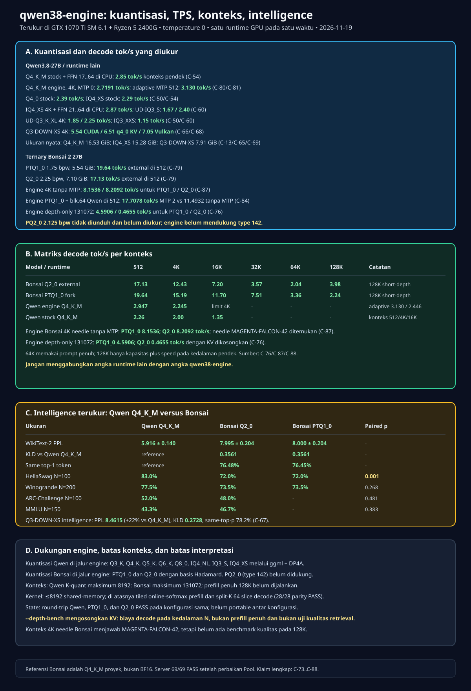

# legacy1070qi38

*Old Hardware, New Intelligence.* Proyek Kiroween 2026 (tema **Resurrection**): menjalankan
**Qwen3.8-27B** pada **GTX 1070 Ti 8 GB (Pascal, SM 6.1) + Ryzen 5 2400G + 16 GB DDR4**, tanpa
mengasumsikan seluruh bobot model muat di VRAM.

Lisensi: Apache 2.0.



## Status (2026-11-19)

Repositori sekarang berisi **dua jalur eksekusi** yang saling melengkapi:

1. **Baseline llama.cpp** lewat `tools/legacy.py`: reproduksi, pengukuran, dan perbandingan model
   K-quant/GGUF yang sudah matang.
2. **Engine khusus `qwen38-engine`**: binary C++/CUDA yang mengimplementasikan sendiri loader GGUF,
   tokenizer, aritmetika CPU AVX2, kernel CUDA SM 6.1, KV `iso3`, MTP + rollback DeltaNet, sampler,
   prefill bertahap, server HTTP/SSE, dan WebUI satu berkas.

Semua angka di bawah diukur di GTX 1070 Ti 8 GB + Ryzen 5 2400G + 16 GB RAM, dengan empat core
fisik, `temperature=0`, `seed=42`, dan tepat satu runtime GPU pada satu waktu. Batas kerja yang
dipakai adalah **7373 MiB VRAM** dan **14,2 GB RAM host** (satuan desimal).

### Hasil utama yang sudah terukur

| Jalur / model | Decode | Bukti dan Interpretasi |
|---|---:|---|
| llama.cpp, Qwen3.8-27B UD-Q4_K_M | **2,85 tok/s** | konfigurasi terbaik lama, 32 layer GPU; C-54 |
| `qwen38-engine`, Qwen3.8-27B UD-Q4_K_M | **2,72 tok/s** | run regresi branch ini, MTP dimatikan; head-to-head Stage 5 mencatat 2,58 tok/s; C-80 |
| `qwen38-engine`, Qwen3.8-27B UD-Q4_K_M + adaptive MTP | **3,13 tok/s** | ronde eksperimen setelah Stage 5; bukan default saat MTP gagal diberi draft yang cukup; C-81 |
| llama.cpp, Ternary Bonsai 2 27B `Q2_0` / `PTQ1_0` | **17,13 / 19,64 tok/s** | runtime stock/PrismML, konteks pendek; C-79 |
| `qwen38-engine`, Bonsai `PTQ1_0` / `Q2_0`, prompt 4K tanpa MTP | **8,15 / 8,21 tok/s** | decode nyata pada prompt needle 4K dengan kernel ternary v2; C-85 |
| `qwen38-engine`, Bonsai `PTQ1_0` + head MTP uji (blk.64 Qwen) | **17,71 tok/s** | prompt 512 + 256 decode, MTP tetap 2; 158/198 draft diterima dan 256 token identik; C-84 |

### Kuantisasi dan intelligence terukur

| Kuantisasi / model | Decode tok/s | Konteks uji | Intelligence / catatan |
|---|---:|---|---|
| Qwen `Q4_K_M` stock + `-ot` FFN 17..64 | 2,85 | pendek | PPL WikiText-2 5,916 (referensi proyek); C-54/C-78 |
| Qwen `Q4_K_M` engine, MTP 0 / adaptive | 2,72 / 3,13 | 4K / 512 | run regresi dan ronde adaptive; C-80/C-81 |
| Qwen `Q4_0` stock | 2,39 | pendek | pembanding Q4; C-54 |
| Qwen `IQ4_XS` stock / 4K `-ot` | 2,29 / 2,87 | pendek / 4K | lebih baik dari IQ3 pada CPU ini; C-50/C-60 |
| Qwen `UD-IQ3_S` `-ngl` / `-ot` | 1,67 / 2,40 | 4K | minimum 2 tok/s hanya lewat `-ot`; C-60 |
| Qwen `UD-Q3_K_XL` `-ngl` / `-ot` | 1,85 / 2,25 | 4K | pengganti IQ3_M; C-60 |
| Qwen `IQ3_XXS` | 1,15 | pendek | quant lebih kecil tidak otomatis lebih cepat; C-50 |
| Qwen `Q3-DOWN-XS` CUDA / q4_0 KV / Vulkan | 5,54 / 6,51 / 7,05 | 4K | berkas nyata 7,91 GiB; PPL 8,4615 (+22%), KLD 0,2728; C-65/C-66/C-67/C-68 |
| Bonsai `PTQ1_0` external (PrismML fork) | 19,64 | 512 | 1,75 bpw, 5,54 GiB; C-79 |
| Bonsai `Q2_0` external (stock llama.cpp) | 17,13 | 512 | 2,25 bpw, 7,10 GiB; C-79 |
| Bonsai `PTQ1_0` / `Q2_0` engine tanpa MTP | 8,1536 / 8,2092 | 4K needle | kernel v2; menjawab needle MAGENTA-FALCON-42; C-87 |
| Bonsai `PTQ1_0` + blk.64 Qwen, MTP 2 | 17,7078 | 512 | plumbing saja, head belum dilatih pada Bonsai; C-84 |
| Bonsai `PQ2_0` | belum diukur | - | tidak diunduh; GGML type 142 belum didukung engine |

Intelligence Bonsai: PPL WikiText-2 **7,995/8,000** untuk `Q2_0`/`PTQ1_0`, versus **5,916** untuk
Qwen Q4_K_M; KLD 0,3561 dan same-top-1 76,48/76,45%. HellaSwag 72% versus 83% (p=0,001);
Winogrande, ARC-Challenge, dan MMLU tidak signifikan pada sampel tersebut. Rincian dan batasan: C-78.

### Matriks konteks terukur

| Model / runtime | 512 | 4K | 16K | 32K | 64K | 128K |
|---|---:|---:|---:|---:|---:|---:|
| Bonsai `Q2_0` stock/PrismML | 17,13 | 12,43 | 7,20 | 3,57 | 2,04 | 3,98 short-depth |
| Bonsai `PTQ1_0` PrismML fork | 19,64 | 15,19 | 11,70 | 7,51 | 3,36 | 2,24 short-depth |
| Qwen Q4_K_M `qwen38-engine` | 2,947 | 2,245 | limit 4K | - | - | - |
| Qwen Q4_K_M stock llama.cpp | 2,26 | 2,00 | 1,35 | - | - | - |

Angka 64K memakai prompt penuh; 128K adalah kapasitas dan speed pada kedalaman pendek, bukan prefill
penuh. Matriks ini berasal dari runtime lain dan `qwen38-engine` versi berbeda, sehingga jangan
digabung sebagai satu baseline (C-88).

### Konteks 128K pada engine khusus

- Attention CUDA memakai **tiled online-softmax** untuk prefill dan **split-K decode (64 slice)**
  di atas 8192 posisi, sehingga `--ctx 131072` dapat diuji pada jalur Ternary Bonsai.
- Auto-fit memilih **64 layer GPU** untuk `PTQ1_0` dan **53 layer GPU** untuk `Q2_0` pada konteks
  131072; puncak VRAM probe adalah **7349 MiB** dan **7295 MiB**.
- Probe biaya decode pada kedalaman 131072 menghasilkan **4,5906 tok/s** (`PTQ1_0`) dan
  **0,4655 tok/s** (`Q2_0`). Angka ini **bukan** hasil prefill 128K penuh: probe `--depth-bench`
  mengosongkan KV, melakukan satu warm-up di posisi `N-33`, lalu mengukur 32 langkah decode di
  posisi `N-32..N-1` tanpa memproses prompt sepanjang itu (C-76).
- Paritas attention lulus pada **28 kasus**, termasuk split-K dan tiled terhadap referensi
  double-precision pada 131072 posisi untuk KV FP32 dan `iso3`; galat relatif tertinggi
  2,581e-05 (C-77).

### Yang sudah ada

| Komponen | Status / bukti |
|---|---|
| `qwen38-engine` | Stage 1–5 selesai: loader, CPU reference, CUDA SM 61, KV `iso3`, MTP/rollback, sampler, server, WebUI; `docs/AFK_STATUS.md` |
| Jalur Ternary Bonsai | `Q2_0` dan `PTQ1_0` pada CPU/GPU, basis Hadamard `prism.hadamard`, kernel ternary v2 bit-identical, serta plumbing MTP dengan head `blk.64` yang bisa disuntikkan; commit `a89f467`, C-84/C-85 |
| Konteks panjang | kernel tiled + split-K hingga 131072 posisi, arena dinamis, auto-fit GPU, budget VRAM/RAM, state save/load; branch `exp/bonsai-128k-context`; batas konteks: C-83 |
| Alat MTP Bonsai | `qwen38-engine/tools/bonsai_mtp_train/`: korpus ChatML, distilasi head, dan penyuntikan `blk.64` ke GGUF |
| Server | `POST /v1/chat/completions` OpenAI-compatible, SSE, telemetry, cache prefix; WebUI tertanam di `webui/index.html` |
| CLI proyek | `tools/legacy.py`: budget, hardware, GGUF, llama, benchmark, kualitas, spec; 127 test unit lulus |
| Spesifikasi dan klaim | SPEC-000..008, RFC-001..004, `spec/research/CLAIMS.md` C-01..C-88; setiap klaim faktual baru harus punya ID |
| CLI untuk executable tunggal | SPEC-008/RFC-004 sudah dispesifikasikan; implementasi embed/mmap **belum** dikerjakan |

### Yang belum

| Batas | Alasan / status |
|---|---|
| Prefill penuh 128K | belum dijalankan; yang ada hanya probe kedalaman Attention, benchmark needle 4K, dan rencana antrian 32K/64K |
| Kualitas pada konteks 128K | belum diukur; `--depth-bench` tidak membuktikan kualitas retrieval |
| Kecepatan tanpa MTP | 8,15/8,21 tok/s pada prompt 4K, masih di bawah llama.cpp/PrismML 17–20 tok/s |
| `PQ2_0` | format GGML type 142 belum didukung; engine mendukung `Q2_0` dan `PTQ1_0` |
| State portable | file state terikat pada fingerprint tensor, jumlah layer GPU, dan format KV; round-trip sudah lulus pada konfigurasi yang sama, tetapi belum punya versi migrasi (C-74) |
| Browser WebUI | logika UI diuji dengan QuickJS, tetapi halaman belum pernah dibuka di browser sungguhan |
| Channel RAM | belum diketahui; perlu pemeriksaan fisik dengan `sudo dmidecode -t memory` |
| Single-file executable | SPEC-008/RFC-004 adalah desain; loader append + mmap belum diimplementasikan |

## Arsitektur ringkas

Qwen3.8-27B adalah model hibrida: 64 layer = 16 x (3 Gated DeltaNet + 1 Gated Attention). Hanya
16 layer yang memiliki KV cache; state DeltaNet berukuran tetap. Karena bobot K-quant terlalu
besar, jalur Qwen membagi 32 layer pertama ke GPU dan sisanya ke CPU. Sebaliknya, Ternary
Bonsai yang bobotnya 1,75–2,25 bit lebih dekat muat seluruh model di VRAM.

`qwen38-engine` menjaga semua buffer token-loop di arena statis, memakai `__dp4a` untuk dot
product integer, FP32 untuk aritmetika aktivasi, `iso3` untuk KV GPU, dan snapshot+replay untuk
rollback DeltaNet ketika draft MTP ditolak. Untuk konteks di atas 8192 posisi, skor attention tidak
lagi muat di shared memory; prefill mem-streaming K/V per 256 posisi dengan online softmax, dan
decode memakai split-K 64 slice yang digabung ulang. Kernel ternary v2 mempertahankan urutan FP32
dan terbukti byte-identical dengan kernel awal.
Detail arsitektur lengkap: [`qwen38-engine/docs/AFK_STATUS.md`](qwen38-engine/docs/AFK_STATUS.md)
dan diagram di atas.

## Mulai cepat

### 1. CLI dan pengukuran baseline

Butuh Python 3.8+ (3.10 yang diuji). Tidak ada dependensi pip.

```bash
git clone --recurse-submodules https://github.com/mcpe500/legacy1070qi38.git
cd legacy1070qi38

# Perkirakan budget tanpa memuat model
python3 tools/legacy.py budget estimate --file-gib 16.53 --vram-gib 8 --ctx 4096

# Periksa header GGUF
python3 tools/legacy.py gguf inspect path/to/model.gguf

# Jalankan unit test CLI
python3 tools/test_legacy.py
```

Daftar subcommand dan batasnya ada di [`tools/README.md`](tools/README.md).

### 2. Build engine khusus

Engine memakai header dan pustaka `libggml` dari build llama.cpp yang sama. Contoh di bawah memakai
submodule fork `iso3` yang sudah ada di repo:

```bash
# Bangun baseline llama.cpp sekali
cmake -S engine/llama.cpp -B "$HOME/llama.cpp/build-iso3" \
  -DGGML_CUDA=ON -DCMAKE_CUDA_ARCHITECTURES=61 -DCMAKE_BUILD_TYPE=Release
cmake --build "$HOME/llama.cpp/build-iso3" -j4

# Bangun qwen38-engine
cd qwen38-engine
cmake -G Ninja -S . -B build -DCMAKE_BUILD_TYPE=Release \
  -DLLAMA_SRC="$HOME/kiroween-2026/legacy1070qi38/engine/llama.cpp" \
  -DLLAMA_BUILD="$HOME/llama.cpp/build-iso3"
ninja -C build -j4
```

Sesuaikan `LLAMA_SRC` dengan lokasi checkout repo. Build wajib memakai `ninja -j4`; jalankan
`scripts/setup.sh` lebih dahulu untuk memeriksa CUDA, driver, CPU, RAM, dan tool yang dibutuhkan.

### 3. Jalankan Qwen atau Bonsai

```bash
cd qwen38-engine

# Qwen K-quant: hybrid CPU/GPU, auto-fit, KV iso3
taskset -c 0-3 ./build/qwen38-engine \
  -m "$HOME/models/27b/Qwen3.8-27B-UD-Q4_K_M.gguf" \
  --gpu-layers auto --ctx 4096 -p "The capital of France is" -n 32 --temp 0 --seed 42

# Ternary Bonsai, mode dekode real (tanpa MTP)
taskset -c 0-3 ./build/qwen38-engine \
  -m "$HOME/models/27b-bonsai/Ternary-Bonsai-2-27B-Q2_0.gguf" \
  --gpu-layers auto --ctx 4096 -p "The capital of France is" -n 16 --temp 0 --seed 42

# Probe biaya decode pada kedalaman 131072 (bukan prefill 128K!)
taskset -c 0-3 ./build/qwen38-engine \
  -m "$HOME/models/27b-bonsai/Ternary-Bonsai-2-27B-PTQ1_0.gguf" \
  --gpu-layers auto --ctx 131072 --depth-bench 131072 -n 33
```

### 4. Jalankan server + WebUI

```bash
cd qwen38-engine
MODEL="$HOME/models/27b/Qwen3.8-27B-UD-Q4_K_M.gguf" scripts/serve.sh --gpu-layers auto --ctx 4096
# buka http://127.0.0.1:8080/
```

Server hanya memproses satu permintaan pada satu waktu. API kompatibel OpenAI tersedia di
`POST /v1/chat/completions`; telemetri, cache prefix, stop string, MTP adaptif, dan PLD dijelaskan
di [`qwen38-engine/README.md`](qwen38-engine/README.md).

## Peta repo

```text
spec/AGENTS/       aturan agen: MASTER.md (baca dulu), roles/, phases/, KIRO-USAGE.md
spec/specs/        SPEC-NNN (requirements, design, tasks), RFC-NNN, assets/ (SVG)
spec/research/     CLAIMS.md: setiap klaim faktual dengan sumber dan status
spec/handoff/      HANDOFF-LOG.md (append-only), catatan sesi
qwen38-engine/     engine khusus: CUDA/CPU, loader, sampler, server, WebUI, tests, bench
qwen38-engine/tools/bonsai_mtp_train/  korpus, distilasi, dan injeksi head MTP Bonsai
qwen38-engine/docs/AFK_STATUS.md  status lengkap Stage 1–5 dan eksperimen
tools/legacy.py    CLI satu file, hanya library standar
tools/agent/       pemantau GitHub untuk komentar /kiro
engine/llama.cpp  fork llama.cpp sebagai submodule (iso3)
patches/          patch iso3 (riwayat); sumber utama sekarang engine/llama.cpp
```

## Cara berkontribusi

- Satu tugas, satu PR. Deskripsi PR memuat teks dan SVG, bukti test, serta daftar "yang belum".
  Aturan lengkap ada di [`spec/AGENTS/MASTER.md`](spec/AGENTS/MASTER.md).
- Klaim faktual baru wajib punya baris di [`spec/research/CLAIMS.md`](spec/research/CLAIMS.md).
- `main` dilindungi; merge hanya oleh pemilik repo.
- Semua operasi shell repo ini memakai RTK, dan build engine memakai `ninja -j4`.
- Komentar `/kiro ...` di issue atau PR dibalas agen, tetapi hanya dari pengguna terdaftar.
