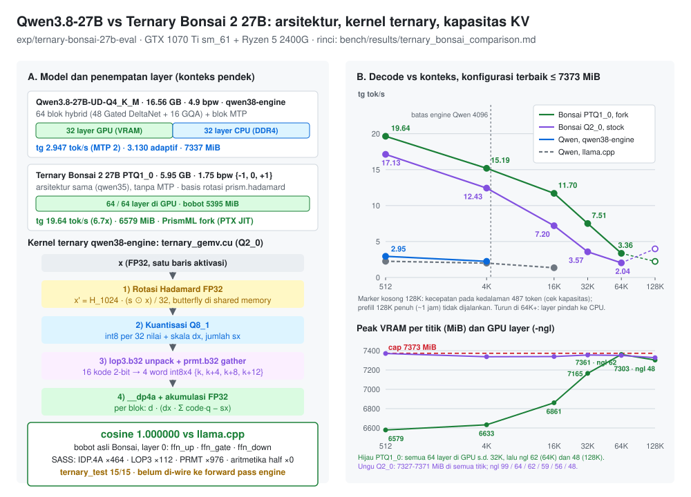

# Ternary Bonsai 2 27B vs Qwen3.8-27B-UD-Q4_K_M on the GTX 1070 Ti (2026-11-17)

Hardware: GTX 1070 Ti (sm_61, 8 GB, **VRAM cap 7373 MiB**), Ryzen 5 2400G on cores 0-3, 16 GB DDR4 (**RAM cap 14.2 GB**), PCIe Gen3 x1.
Every run was alone on the GPU (checked with `nvidia-smi` before each run), temperature 0, seed 42. Raw files: `bench/results/bonsai/`.
Peak VRAM = highest `nvidia-smi` sample (100 ms) during the run. "OK" = peak at or under 7373 MiB.
Every step in order (27 steps, reason / command / output / decision): `bench/results/bonsai/EXPERIMENT-LOG.md`. Every run with its exact peak VRAM (42 rows):
`bench/results/bonsai/RUNS.md`, generated by `python3 bench/bonsai_ledger.py`. Figure: `docs/figures/50_ternary_bonsai.svg`.



## Summary

- **Ternary Bonsai 2 27B decodes about 6x faster than Qwen3.8-27B Q4_K_M on this card**: 17-20 tok/s against 2.3-3.1 tok/s at short context,
  because the whole model (or almost all of it) fits in VRAM, while Q4_K_M keeps 32 of its 64 layers in DDR4.
- Prompt processing is also faster at short and medium context: `Q2_0` 183 tok/s (Qwen 28-35), `PTQ1_0` 99 tok/s.
- **Longest usable contexts under 7373 MiB** (measured): 32K with every `PTQ1_0` layer on the GPU (7.5 tok/s at 32K depth),
  64K (`Q2_0` + iso3, 56 GPU layers, 2.0 tok/s at 64K depth; `PTQ1_0` + q4_0, 62 GPU layers, 3.4 tok/s), and 128K (capacity only: loads and runs at
  7219-7327 MiB with 46-48 GPU layers; a full 128K prefill was not run, about 1 hour).
- Answer quality: 6/6 checks passed for both models (arithmetic, facts, word problem, translation into Indonesian, code, one reasoning question).
- Architecture is the Qwen3.8-27B hybrid (48 Gated DeltaNet + 16 GQA attention layers) with ternary weights and a Hadamard-rotated basis; **no MTP head**.
- In qwen38-engine a ternary GEMV path (Q2_0 unpack with `lop3.b32`, activation lanes gathered with `prmt.b32`, `__dp4a`, FP32 Hadamard rotation) was built and
  verified: cosine 1.000000 against llama.cpp on real Bonsai weights, SASS gate PASS. It is **not yet wired into the engine forward pass** (see "Not done").

## 1. Model and architecture (from the GGUF headers, read with HTTP range requests before downloading)

| Item | Ternary Bonsai 2 27B | Qwen3.8-27B-UD-Q4_K_M |
|---|---|---|
| Architecture key | `qwen35` (hybrid) | `qwen35` (hybrid) |
| Blocks | 64 (no MTP block) | 64 + MTP block 64 |
| Hidden / FFN | 5120 / 17408 | 5120 / 17408 |
| Attention | 24 Q heads, 4 KV heads, head_dim 256, every 4th layer (16 layers) | same |
| Gated DeltaNet | 48 layers, 48 V heads x 128, 16 groups, conv 4 | same |
| Vocabulary / context | 248320 / 262144 | 248320 / 262144 |
| Weights | ternary {-1, 0, +1}, FP16 scale per group; `PTQ1_0` (type 143, 1.75 bpw, 5.95 GB), `PQ2_0` (type 142, 2.125 bpw, 7.21 GB), `Q2_0` (type 42, 2.25 bpw, 7.63 GB) | K-quants/IQ mix, 4.9 bpw, 16.56 GB |
| High-precision tensors | 96 BF16 (`ssm_alpha`, `ssm_beta`), 353 F32 (norms, conv, `ssm_a`, `dt`) | F32 norms etc. |
| Activation transform | `prism.hadamard`: x' = H_1024 (s * x) on the input of 401 matrices (block 1024, explicit +/-1 signs for widths 5120, 6144, 17408; grouped V order for `ssm_out`); `token_embd` stored rotated (inverse transform after lookup) | none |
| Runtime support | `Q2_0`: stock llama.cpp >= b11556 (our build `fc9437a` has it); `PTQ1_0`/`PQ2_0`: PrismML fork only (`prism-b12128`, runs on sm_61 through PTX JIT) | qwen38-engine, llama.cpp |

The TQ1_0/TQ2_0/I2_S types named in the request are **not** used by this model; the files use the formats above.

## 2. Speed (pp = prompt processing, tg = decode, tok/s)

`llama-bench` rows: pp512 and tg128 measured at depth d (d tokens already in the KV cache). Server rows: one request with a prompt of the stated length, then 128 tokens.
qwen38-engine rows: the full prompt is processed (prefill rate), then the reply is generated.

| Model, runtime, configuration | 512 (d 0) | 4K | 16K | 32K | 64K | 128K | Peak VRAM MiB |
|---|---|---|---|---|---|---|---|
| **Bonsai `Q2_0`**, stock llama.cpp, q4_0 KV, `-ub 128`; `-ngl` 99 / 64 / 62 / 59 | pp **182.7** tg **17.13** | pp 139.2 tg 12.43 | pp 89.1 tg 7.20 | pp 59.1 tg 3.57 | - | - | 7371 / 7337 / 7339 / 7355 |
| Bonsai `Q2_0`, stock, **iso3 KV**, `-ub 128`, server | | | | | 64,988-token prompt: pp 49.1, tg **2.04** at 65K (`-ngl 56`) | 487-token prompt at `-c 131072`: pp 35.3 tg 3.98 (`-ngl 48`, capacity check) | 7351 / 7327 |
| **Bonsai `PTQ1_0`**, PrismML fork, every layer on the GPU (`-ngl 99`); f16 KV at d 0, q4_0 KV after | pp 98.9 tg **19.64** | pp 92.7 tg **15.19** | pp 77.2 tg **11.70** | pp 66.0 tg **7.51** | - | - | 6579 / 6633 / 6861 / 7165 |
| Bonsai `PTQ1_0`, fork, q4_0 KV, server | | | | | 64,988-token prompt: pp 59.1, tg 3.36 at 65K (`-ngl 62`) | 487-token prompt at `-c 131072`: pp 41.0 tg 2.24 (`-ngl 48`) | 7361 / 7303 |
| Bonsai `Q2_0`, PrismML fork, q4_0, `-ub 128`, `-ngl 99` | pp 182.5 tg 18.67 | | | | | | 7365 |
| Qwen3.8-27B Q4_K_M, **qwen38-engine `main`** (32 GPU layers, iso3, dp4a, MTP 2) | 509-token prompt: pp 27.9, tg **2.95** (adaptive MTP: 3.13) | 3924-token prompt: pp 24.2, tg **2.25** (adaptive: 2.45) | engine limit 4096 | | | | 7337 / 7361 |
| Qwen3.8-27B Q4_K_M, stock llama.cpp, q4_0 KV, no MTP; `-ngl` 25 / 25 / 24 | pp 30.0 tg 2.26 | pp 34.8 tg 2.00 | pp 32.0 tg 1.35 | | | | 6945 / 6973 / 6835 |

**Reading.**
- At short context Bonsai `PTQ1_0` decodes 6.7x faster than the qwen38-engine baseline (19.6 vs 2.95 tok/s) and `Q2_0` 5.8x (17.1). At 4K the gap is 6.8x (`PTQ1_0` 15.2 vs 2.25).
- Decode falls with depth for every configuration because the 16 attention layers read a longer KV cache each token; it falls faster when layers have to move to the CPU
  (the stock CPU path for `Q2_0` and the fork's release CPU path for `PTQ1_0` are slow: about 15 ms per CPU layer per token for `Q2_0`).
- `Q2_0` (2.25 bpw) is 1.8x faster at prompt processing than `PTQ1_0` (the dense trits cost arithmetic to unpack on Pascal), but needs 1.5 GB more VRAM, so at 16K+ it runs with CPU layers.
- MTP is not available for Bonsai (no MTP block in the files); every Bonsai number is plain decoding.
- The user's baseline "3.01-3.32 tok/s at ctx 4096" was measured with adaptive MTP on prompts up to 512 tokens. On the real 3924-token prompt the engine measures 2.25-2.45 tok/s.

## 3. KV cache capacity under 7373 MiB

### 3.1 Exact sizes (from the headers)
| Packing | GPU weights (64 blocks + output) MiB | token_embd (stays on host) MiB |
|---|---:|---:|
| `Q2_0` | 6921.1 | 341.0 |
| `PQ2_0` (not downloaded, computed) | 6539.7 | 322.1 |
| `PTQ1_0` | 5395.3 | 265.2 |

KV cache of the 16 attention layers: **f16 64 KiB, q8_0 34 KiB, q4_0 18 KiB, iso3 12.5 KiB per token**. The DeltaNet state is a constant 149.6 MiB.
Runtime overhead (measured, `bench/results/bonsai/overhead.md`): about 320 MiB at 4K and **+6.1 KiB per context token** (stock build; 1080 MiB at 128K);
the PrismML fork adds about 350 MiB more at the first request.

### 3.2 Largest context with every layer on the GPU (model, `bench/results/bonsai/kv_capacity.md`)
| Packing | f16 | q8_0 | q4_0 | iso3 |
|---|---:|---:|---:|---:|
| `Q2_0` | ~100 | ~190 | ~310 | ~400 (weights alone leave 7 MiB) |
| `PQ2_0` | 5.7K | 9.9K | 16.5K | 21.4K |
| `PTQ1_0` | 22.4K | 39.1K | 65.1K | **84.4K** (iso3 is not in the PrismML fork: needs our patch ported) |

### 3.3 Measured configurations (load and peak VRAM; `bench/results/bonsai/overhead.md` splits them into parts)
| Context | `Q2_0` + stock llama.cpp | `PTQ1_0` + PrismML fork |
|---|---|---|
| 4K | q4_0, `-ngl 64` (output on CPU), 7337 MiB | q4_0, every layer, 6633 MiB |
| 16K | q4_0, `-ngl 62`, 7339 MiB | f16 7089 MiB, q4_0 6861 MiB, every layer |
| 32K | f16 does not load (OOM), q8_0 7855 (over), q4_0 7343, **iso3 7167** with `-ngl 59` | q8_0 7271, q4_0 7165, every layer |
| 64K | **iso3, `-ngl 56`, 7351 MiB** | q4_0: every layer 7471 / 7595 (over), `-ngl 62` 7361 MiB |
| 128K | iso3: `-ngl 48` 7327 MiB (51: 7739 over); q4_0: `-ngl 43` 7227 MiB | q4_0, `-ngl 48`, 7303 MiB |
| 256K | not tried (iso3 KV alone 3.2 GiB plus about 1.9 GiB overhead) | not tried |

RAM was not sampled in the llama.cpp runs; computed, it stays far under 14.2 GB: the mapped files are 7.1 GiB (`Q2_0`) and 5.5 GiB (`PTQ1_0`), and the KV cache
of the CPU layers at 128K is 400-720 MiB (4-5 attention layers on the CPU). The qwen38-engine Qwen run on the 4K prompt measured 9352 MiB peak RSS.
Nothing spills to DDR4 silently: llama.cpp allocates the whole KV cache at load and fails if it does not fit (f16 at 32K: `cudaMalloc failed: out of memory` for 1920 MiB).

### 3.4 Shared memory (48 KiB per block on sm_61)
qwen38-engine keeps the attention scores of one query row in dynamic shared memory (4 bytes per position + about 1.1 KiB), so its kernel can address at most
about 12,000 positions; the engine stays at 4096 on purpose. llama.cpp's flash-attention kernels tile the KV sequence, so shared memory does not limit their context.

## 4. Ternary path in qwen38-engine (prepared, verified, not yet wired in)

`src/cuda/ternary_gemv.cu`:
- `ternary_rotate`: x' = H_1024 (s * x) / 32, FP32 butterflies in shared memory (one 1024-block per thread block).
- `gemv_q2_0_dp4a`: Q2_0 rows (18-byte blocks); 16 codes at a time unpacked with `lop3.b32` into four int8x4 words whose lanes hold weights {k, k+4, k+8, k+12};
  the matching activation bytes are gathered with `prmt.b32`; `__dp4a` over Q8_1 activations; `d * (dx * sum(code * q) - sx)` per 32-value block; FP32 accumulation.

| Test | Result |
|---|---|
| `tests/cuda/ternary_test.cu` (synthetic, 3 shapes) | Q2_0 decode = libggml `to_float` (0 mismatches); rotation vs double Sylvester-Hadamard rel. RMS 8.6e-8; GEMV vs same-activation double reference 8-10e-8; vs FP32 activation 5.3-5.6e-3 (8-bit activation); T = 1 result bit-identical to the same row of T = 11 |
| `tests/cuda/ternary_real_test.cu` (real Bonsai `Q2_0` weights, layer 0, llama.cpp's own input and output tensors) | `ffn_up`, `ffn_gate`, `ffn_down`: **cosine 1.000000 against llama.cpp**, 0.99999 against a double reference |
| SASS gate | PASS: `ternary_gemv` IDP.4A x464, LOP3 x112, PRMT x976, HFMA2/HMUL2/HADD2 x0 |

## 5. Answer quality (sanity, `bench/results/bonsai/sanity_*.json`)
| Prompt | Bonsai `Q2_0` (llama-server, 64 GPU layers, iso3) | Qwen Q4_K_M (qwen38-engine server) |
|---|---|---|
| 17 x 23 | 391 | 391 |
| Capital of Australia | Canberra | Canberra |
| 120 km in 1.5 h | 80 | 80 |
| Translate into Indonesian | "Pertemuan dimulai pukul sembilan besok pagi." | "Rapat dimulai pukul sembilan besok pagi." |
| `is_prime` in Python (structure checked, not executed) | correct structure | correct structure |
| 20 % discount reasoning (thinking on, effort medium) | 31.25 (153 tokens) | 31.25 (102 tokens) |
| **Passed** | **6 / 6** | **6 / 6** |
This is a sanity check, not a benchmark; the model card reports 84.78 vs 86.32 (FP16 Qwen) on 14 thinking-mode benchmarks.

## 6. Failed attempts (root cause and fix; details in `EXPERIMENT-LOG.md` section 2)
| ID | Attempt | Exact result | Root cause | Fix |
|---|---|---|---|---|
| F1 | `Q2_0`, every layer on the GPU, ubatch 512 | 7791 MiB (llama-bench), 7647 MiB (server, 4K f16) | 6921 MiB of weights leave 452 MiB for KV, state and compute buffer | `-ub 128` + q4_0: 7371 MiB |
| F2 | `Q2_0` 32K, f16 / q8_0 KV, `-ngl 59` | f16 `cudaMalloc failed: out of memory` (1920 MiB); q8_0 7855 MiB | KV of 15 GPU attention layers: f16 1920 MiB, q8_0 1020 MiB | q4_0 7343 MiB, iso3 7167 MiB |
| F3 | first 64K prompt | `request (69447 tokens) exceeds the available context size (65536 tokens)` | per-line token estimate too low (27 vs about 30) | prompt sized with the server's `/tokenize` |
| F4 | second 64K prompt | pp 49.07, `predicted_n = 1` | greedy decode emitted the end token at once | `ignore_eos: true` |
| F5 | 128K, iso3 `-ngl` 51 / 52, q4_0 `-ngl 48` | 7739 / 7847 / 7899 MiB | runtime overhead grows about 6.1 KiB per context token | iso3 `-ngl 48` 7327 MiB, q4_0 `-ngl 43` 7227 MiB |
| F6 | `PTQ1_0` 64K, every layer on the GPU (ub 128 / 512) | peak 7471 / 7595 MiB (load 7121 / 7245) | the fork allocates about 350 MiB more at the first request | `-ngl 62`: 7361 MiB |
| F7 | capacity calculator v1 | predicted 24.7K tokens for `Q2_0` + iso3 all on the GPU | overhead set to zero | v2 with measured overhead: about 400 tokens |
| F8 | benchmarks while downloading | avoided | page-cache pressure evicts CPU-layer weights | Qwen runs waited; download paused with SIGSTOP |
| F9 | 128K full prompt | not run | about 1 hour of prefill | capacity + short-depth speed only |

No kernel test failed: `ternary_test` 15/15 and `ternary_real_test` cosine 1.000000 on the first build.

## 7. Not done / limits
- The ternary kernels are not wired into qwen38-engine's forward pass. Missing for that: a 64-block model without MTP (the engine checks `block_count = 65`), the rotation before every
  folded matrix (including the grouped V order of `ssm_out` and the inverse rotation of `token_embd`), BF16 `ssm_alpha`/`ssm_beta`, and the CPU path for CPU layers.
  With all 64 layers on the GPU the engine's own buffers would not fit next to `Q2_0` (6.9 GB); `PTQ1_0` would need its own unpack kernel.
- `PQ2_0` was not downloaded (7.2 GB more); its numbers above are computed only.
- 128K and 64K points are capacity checks plus one long run each; the 128K decode speed was measured at a short depth only.
- Long-context prompts are synthetic (numbered report lines) and `llama-bench` depth tokens are synthetic; quality at long context was not measured.
- The PrismML fork is a prebuilt release (`prism-b12128`, sha256 verified) running through PTX JIT; its CPU kernels for `PTQ1_0` are the slow release ones (the fast AVX2 kernels are only in source).

## 8. Reproduce
```bash
python3 tests/tools/gguf_remote_header.py https://huggingface.co/prism-ml/Ternary-Bonsai-2-27B-gguf/resolve/main/Ternary-Bonsai-2-27B-Q2_0.gguf --json bench/results/bonsai/header_Q2_0.json
python3 bench/bonsai_kv_capacity.py --md bench/results/bonsai/kv_capacity.md
python3 bench/bonsai_overhead.py --md bench/results/bonsai/overhead.md
python3 bench/bonsai_ledger.py        # rewrites bench/results/bonsai/RUNS.md
UB=128 bench/bonsai_bench.sh probe  MODEL ~/llama.cpp/build-iso3/bin TAG q4_0 16384 62      # llama-bench pp512/tg128 at depth
UB=128 bench/bonsai_bench.sh server MODEL ~/llama.cpp/build-iso3/bin TAG iso3 65536 56 65000 # llama-server, full-length prompt
ninja -C build -j4 ternary_test ternary_real_test && ./build/ternary_test && ./build/ternary_real_test MODEL REF_DIR
python3 tests/tools/sanity_prompts.py http://127.0.0.1:8097 bonsai bench/results/bonsai/sanity_bonsai.json
```
