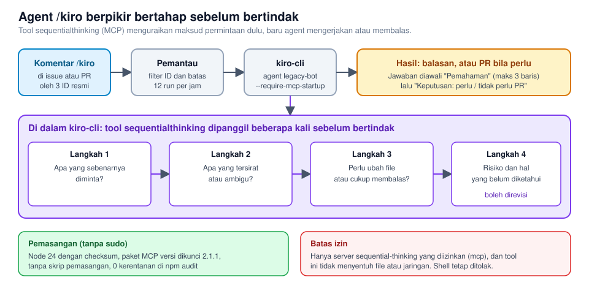

# Penggunaan Kiro dalam Proyek legacy1070qi38

Dokumen ini mencatat apa yang **benar-benar dilakukan Kiro** dalam proyek ini, untuk
menjawab syarat submission: *"Name each product you used and what it does in your project
(Kiro tools, custom agents, hooks, specs, steering, MCP, PBT, powers)."*

> Prinsip dokumen ini: hanya mencatat fitur yang benar-benar dipakai. Fitur yang belum
> dipakai ditandai jelas pada bagian "Belum Digunakan". Update dokumen ini setiap kali
> ada fitur Kiro baru yang dipakai.

---

## Ringkasan

| Fitur Kiro | Dipakai? | Peran di proyek |
|---|---|---|
| Kiro CLI (`kiro-cli chat`) | ✅ Ya | Antarmuka utama seluruh sesi kerja |
| Knowledge base (`knowledge` tool) | ✅ Ya | Folder `spec/` diindeks (38 berkas, BM25) lalu dicari dengan pertanyaan bahasa Indonesia; lihat bagian 10 |
| Planning agent (plan → handoff ke execution) | ✅ Ya | Requirements gathering + rencana implementasi sebelum menulis file |
| Sub-agent `context-gatherer` | ✅ Ya | Riset teknis hardware/model, dan menulis file spec secara paralel |
| Built-in tools (read/list/search file) | ✅ Ya | Membaca dan memverifikasi isi workspace |
| Live steering | ✅ Ya | User menyisipkan instruksi saat sub-agent sedang berjalan |
| Web search dan web fetch | ✅ Ya | Memverifikasi model dan arsitektur; menangkap kesalahan asumsi awal |
| Headless mode (`--no-interactive`) | ✅ Ya | Menjalankan Kiro dari skrip pemantau GitHub tanpa sesi interaktif |
| Custom agent + permissions (`~/.kiro/agents/legacy-bot*.json`) | ✅ Ya | Profil agent bot dengan aturan izin per path dan tool; diuji menolak akses terlarang |
| Spec-driven development (requirements → design → tasks) | ✅ Ya (struktur) | Format `SPEC-NNN-*/` mengikuti pola requirements/design/tasks |
| Hooks | ✅ Ya | `.kiro/hooks/spec-validate-on-save.json` (`PostFileSave`, pola `spec/.*\.md$`) menjalankan `legacy.py spec validate`; dibuat lewat tool `createHook` |
| Steering files (`.kiro/steering/`) | ❌ Belum | — |
| Skills (`.kiro/skills/`) | ❌ Belum | — |
| MCP servers | ✅ Ya | Sequential Thinking MCP (`@modelcontextprotocol/server-sequential-thinking` 2.1.1) dipakai agent GitHub `/kiro` untuk menguraikan maksud permintaan sebelum bertindak |
| Property-based testing (PBT) | ⚠️ Sebagian | `BudgetProperties` di `tools/test_legacy.py`: properti diuji pada 300 kasus acak (seed tetap), **tanpa library PBT** seperti Hypothesis |
| Powers | ❌ Belum | — |

---

## Detail Penggunaan

### 1. Kiro CLI (`kiro-cli chat`)
Seluruh sesi bootstrap proyek dijalankan lewat `kiro-cli chat` di terminal Linux.
Workspace: `/home/ivan/kiroween-2026/legacy1070qi38`.

### 2. Planning agent
Sesi dimulai dalam mode perencanaan (read-only): Kiro menanyakan klarifikasi
terstruktur (maks. 3 pertanyaan per giliran), merangkum requirement, lalu menyusun
rencana bertahap (Task 1–8). Setelah user menyetujui, rencana diserahkan ke mode
eksekusi untuk menulis file.

Keputusan yang lahir dari tahap ini (dijawab user):
- Format spec: hybrid (feature spec + RFC)
- AGENTS: hirarkis (`MASTER.md` + `roles/` + `phases/`)
- Handoff: session-based + continuous log
- Penamaan: `SPEC-NNN-nama`
- Kedalaman: dianalisis dulu, karena angka performa belum terukur

### 3. Sub-agent `context-gatherer`
Dipanggil lewat tool `invoke_sub_agent`. Dipakai untuk dua hal:
- **Riset**: analisis kelayakan awal (dengan asumsi model yang kemudian terbukti salah) pada GTX 1070 Ti (Pascal SM 6.1) + 16GB RAM —
  memory footprint, kuantisasi, estimasi TPS, bottleneck. Hasilnya menjadi dasar
  `RFC-001-quantization-strategy.md` dan tabel memory budget di `MASTER.md`.
- **Penulisan file**: membuat file di `spec/` secara paralel (roles, phases, specs, handoff).

Catatan kejujuran: sub-agent ini adalah agent bawaan Kiro, bukan custom agent yang
didefinisikan sendiri oleh proyek ini. Hasil risetnya berbasis pengetahuan model;
angka Qwen3 adalah **asumsi** yang belum diverifikasi (lihat Open Questions di `MASTER.md`).

### 4. Built-in tools
`read_file`, `list_directory`, `file_search`, `grep_search` — dipakai untuk membaca
LICENSE, memeriksa struktur workspace, dan memverifikasi file yang dibuat sub-agent.

### 5. Live steering
Saat sub-agent sedang menulis file, user mengirim pesan tambahan (ID
`steer-be120d5b-77b5-46fb-8eaf-9ae9a2d3a6cc`) agar penggunaan Kiro didokumentasikan.
Pesan itu diterima tanpa menghentikan sesi dan menghasilkan dokumen ini.

### 6. Spec-driven development
Struktur `spec/specs/SPEC-NNN-*/{requirements,design,tasks}.md` mengikuti pola spec
Kiro. Tambahan khas proyek ini (bukan bawaan Kiro): RFC untuk keputusan arsitektur,
`spec/AGENTS/` untuk instruksi agent, dan `spec/handoff/` untuk transisi antar sesi.

---

### 7. Web search dan web fetch
Dipakai setelah bootstrap untuk memeriksa nama model "Qwen 3.8 27B" yang disebut user. Hasilnya menunjukkan
bahwa riset awal sub-agent (berbasis pengetahuan model, tanpa sumber) memakai arsitektur yang salah:
bukan transformer biasa 52 layer, melainkan hibrida 64 layer (16 full attention + 48 Gated DeltaNet).
Dokumen `MASTER.md`, `RFC-001`, `SPEC-000`, `SPEC-002`, `SPEC-004`, `SPEC-005` dikoreksi dengan sumber model card.
Riwayat koreksi ada di `spec/handoff/HANDOFF-LOG.md`.

Pelajaran: klaim faktual wajib bersumber. Pencarian kedua (2026-11-13) mengambil kartu resmi `Qwen/Qwen3.8-27B`,
diskusi dan issue llama.cpp, serta dokumentasi vLLM; hasilnya ada di `spec/research/CLAIMS.md` (48 klaim, tiap baris punya jenis sumber).
Hasil penting: "Qwen3.8-9B" ternyata distilasi komunitas, dan fork kita tidak punya MTP.

### 8. Headless mode dan custom agent (agen GitHub `/kiro`)
`tools/agent/kiro_gh_agent.py` memantau issue GitHub. Perintah `/kiro` dari tiga ID yang diizinkan menjalankan
`kiro-cli chat --v3 --no-interactive --agent legacy-bot-noshell` memakai login Kiro yang ada.

- **Custom agent:** dua profil (`legacy-bot`, `legacy-bot-noshell`) ditulis oleh `install-agent` ke `~/.kiro/agents/`.
  Memuat daftar tool (`read`, `write`, `web`, dan `shell` hanya di profil bersandbox) dan `permissions.rules`.
- **Permissions:** `deny` untuk menulis ke `tools/agent`, `.github`, `.kiro`, `.git`; `deny` untuk membaca `~/.ssh`,
  `~/.config/gh`, folder status; tulis hanya di worktree.
- **Bukti uji nyata** (RFC-003): pembacaan token `gh` ditolak, perubahan `tools/agent/config.json` ditolak,
  penulisan ke `/tmp` tidak terjadi, perintah dari ID yang sah menghasilkan balasan dan PR.
- Kode dan aturan ditulis dengan bantuan Kiro (sesi ini). Uji coba memakai issue #13 sampai #15 dan PR #16, #17 (sudah ditutup).

### 9. MCP: Sequential Thinking untuk agent `/kiro`
Server MCP resmi `@modelcontextprotocol/server-sequential-thinking` (versi dikunci 2.1.1) dipasang lewat
`tools/agent/install-sequential-thinking.sh` dan didaftarkan di profil agent bot (`mcpServers`), bukan di
konfigurasi global. Agent diwajibkan memakainya sebelum bertindak, lalu menulis bagian "Pemahaman" di jawabannya.

- **Bukti uji:** agent memuat dan memanggil tool dua kali tanpa meminta izin (`thoughtHistoryLength` = 2); satu
  perintah `/kiro` nyata di issue menghasilkan jawaban dengan "Pemahaman" dan keputusan "tidak perlu PR" tanpa PR.
- **Pengaman:** izin `mcp` hanya untuk `sequential-thinking/*`; `--require-mcp-startup` membuat run gagal jelas bila
  server tidak naik, bukan diam-diam berjalan tanpa tool itu.
- **Catatan:** Kiro melarang agent menulis ke `~/.kiro/settings/`, jadi pendaftaran global untuk sesi interaktif
  dilakukan manual dengan `kiro-cli mcp add` (perintahnya dicetak oleh skrip pemasangan).

### 10. Hooks dan Knowledge base
- **Hook:** `.kiro/hooks/spec-validate-on-save.json` memicu `python3 tools/legacy.py spec validate` setiap berkas
  `spec/**/*.md` disimpan. Perintah yang sama sudah dijalankan tangan (`ok: True`). **Belum diamati terpicu**; hook
  aktif pada sesi berikutnya.
- **Knowledge base:** `knowledge add` pada `spec/` (indeks `fast`/BM25, 38 berkas) lalu `knowledge search`
  "berapa KV cache per token Qwen3.8-27B". Hasil pertama benar (`SPEC-004/design.md`), tetapi peringkat BM25
  kasar: hasil kedua dan ketiga hanya `HANDOFF-LOG.md`. Untuk tanya-jawab dokumen yang presisi, indeks
  semantik (`best`) belum dicoba.

---

## Belum Digunakan (rencana)

- **Hooks tambahan**: kandidat — auto-update `HANDOFF-LOG.md` setelah task selesai, atau
  pengingat memeriksa daftar approach terlarang saat file spec disimpan. (Satu hook sudah dipakai: lihat bagian 10.)
- **Steering files**: kandidat — memindahkan hardware constraints dari `MASTER.md`
  ke `.kiro/steering/` agar otomatis dimuat di setiap sesi.
- **PBT**: kandidat saat ada kode, mis. properti "estimasi VRAM selalu ≥ ukuran weights".
- **MCP kustom (buatan sendiri)**: opsional. Jalur utama adalah CLI `tools/legacy.py` (RFC-002; sudah ada,
  lihat PR #18). Pembungkus MCP baru dibuat jika diperlukan. Diskusi di GitHub issue #1.
- **Powers / Skills**: skills direncanakan (`vram-budget`, `run-benchmark`, `update-handoff`);
  powers belum ada kebutuhan konkret.

Hooks (`.kiro/hooks`) dan steering files di dalam repo sengaja dilarang untuk agen bot, karena menentukan perilaku agent pada run berikutnya.

Saat salah satu dipakai, pindahkan ke bagian "Detail Penggunaan" beserta buktinya.

---

*Dokumen ini ditulis ulang agar akurat. Versi sebelumnya memuat klaim tool yang tidak
benar-benar dipakai.*
