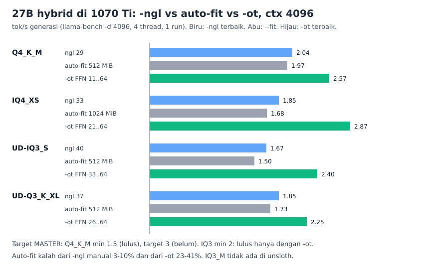

# 27B ctx 4096: tabel quant, auto-fit vs manual (run-003)

Bagian dari #33 dan #31. 2026-11-15, GTX 1070 Ti 8 GB, Ryzen 5 2400G, llama.cpp utama `3549c27` + patch iso3 (`~/llama.cpp/build-iso3/bin`), 4 thread, KV f16.
Alat: `tools/bench27b/ctx_bench.py` (satu `llama-bench -p 0 -n 16 -d 4096 -r 1`, sampel RAM/VRAM tiap detik). Mentah: `~/27b-results/c4096-*.json` dan `.err`.

## Berkas

| Berkas | Ukuran | sha256 vs LFS oid |
|---|---:|---|
| `Qwen3.8-27B-UD-IQ3_S.gguf` | 12 040 883 104 | cocok (`d847e2c1...`) |
| `Qwen3.8-27B-UD-Q3_K_XL.gguf` | 13 146 393 504 | cocok (`7b20f067...`) |

**[CONFLICT]** Issue #33 menyebut IQ3_M. `unsloth/Qwen3.8-27B-GGUF` tidak punya IQ3_M (daftar berkas dari API HF). Pengganti yang diuji: UD-IQ3_S dan UD-Q3_K_XL. Baris prediksi "IQ3_M" di MASTER/RFC-001 tidak diuji langsung; IQ3_S dipakai sebagai wakil terdekat dan **bukan** IQ3_M.

## Tabel (ctx 4096, kedalaman 4096 + 16 token generasi)

"Layer GPU" dari log `offloaded N/66`. Pada `-ot`, 66/66 layer ada di GPU tetapi bobot FFN layer k..64 dipindah ke CPU. "RAM puncak" = RAM tersedia awal dikurangi terendah (penurunan MemAvailable). Bobot mmap yang dibaca dari berkas dihitung sebagai page cache, jadi angka ini **meremehkan** RAM sebenarnya; pemakaian RAM puncak tetap jauh di bawah batas 15 GiB.

| Quant (file GiB) | Konfigurasi terbaik | TPS | VRAM puncak (MiB) | RAM tersedia terendah (GiB) | Layer GPU |
|---|---|---:|---:|---:|---|
| Q4_K_M (15.4) | `-ngl 29` | 2.04 | 7929 | 13.48 | 29/66 |
| Q4_K_M | `-ngl 99 -ot` FFN 11..64 CPU | **2.57** | 7903 | 13.71 | 66/66 (FFN 11..64 di CPU) |
| IQ4_XS (13.4) | `-ngl 33` | 1.85 | 7879 | 13.48 | 33/66 |
| IQ4_XS | `-ot` FFN 21..64 | **2.87** | 7959 | 13.64 | 66/66 |
| UD-IQ3_S (11.2) | `-ngl 40` | 1.67 | 8025 | 13.15 | 40/66 |
| UD-IQ3_S | `-ot` FFN 33..64 | **2.40** | 8051 | 13.53 | 66/66 |
| UD-Q3_K_XL (12.2) | `-ngl 37` | 1.85 | 7971 | 13.41 | 37/66 |
| UD-Q3_K_XL | `-ot` FFN 26..64 | **2.25** | 8043 | 13.59 | 66/66 |

Swap bertambah ≤ 0.2 GiB di semua baris (Q4_K_M 0.18 GiB pada `-ot` 11). Satu run per titik; simpangan tidak diukur kecuali tertulis. IQ4_XS ngl 32/33/34 memberi 1.09/1.85/0.56: tidak monoton, jadi pada VRAM 8 GiB ±1 layer membuat hasil berayun (VRAM puncak 8071 MiB di ngl 34 = hampir penuh, kemungkinan spill/thrash; hipotesis, belum diuji).

Sapuan penuh ada di `~/27b-results/c4096-*.json`: Q4_K_M `-ot` k=7/9/11/12 = 2.43/2.47/2.57/2.56, k≥13 OOM; IQ4_XS k=13..21 = 2.30/2.41/2.46/2.77/2.87, k≥23 OOM; IQ3_S k=30/32/33 = 2.18/2.34/2.40, k≥34 OOM; Q3_K_XL k=26 2.25, k≥27 OOM.

**Perbedaan dengan bench pendek (C-54):** pada ctx pendek Q4_K_M `-ot` k=17 memberi 2.85 tok/s. Pada kedalaman 4096 k=17 OOM (buffer RS dan KV bertambah ±0.4 GiB), k terbaik turun ke 11, TPS 2.57 (-10%).

## OQ-014: auto-fit vs manual

`--fit on` adalah bawaan; yang diuji `-fitt <MiB> -fitc 4096` tanpa `-ngl`/`-ot`.

| Quant | auto-fit (`-fitt`) | layer hasil fit | -ngl manual terbaik | -ot terbaik | fit vs -ngl | fit vs -ot |
|---|---:|---:|---:|---:|---:|---:|
| Q4_K_M | 1.97 (512) / 1.88 (1024) | 27 / 25 | 2.04 | 2.57 | -3% | -23% |
| IQ4_XS | 1.68 (1024) | 29 | 1.85 | 2.87 | -9% | -41% |
| UD-IQ3_S | 1.50 (512) | 37 | 1.67 | 2.40 | -10% | -38% |
| UD-Q3_K_XL | 1.73 (512) | 35 | 1.85 | 2.25 | -6% | -23% |

Jawaban: auto-fit selalu aman (tidak pernah OOM di 6 percobaan) tetapi memilih 2-3 layer lebih sedikit daripada batas manual dan tidak menyentuh `-ot`. Margin kecil (`-fitt 512`) lebih baik dari 1024. Kehilangan 3-10% dari `-ngl` terbaik dan 23-41% dari `-ot` terbaik. Rekomendasi: `-ngl 99 -ot` FFN dengan k dicari lewat sapuan; auto-fit hanya titik awal. (Satu percobaan awal Q4_K_M `-fitt 1024` 1.79 tok/s dibuang dari tabel: parser log mengambil percobaan pertama, bukan hasil akhir fit; sudah diperbaiki di `ctx_bench.py`; hasil ulang 1.88.)

## Prediksi vs hasil (MASTER, RFC-001)

Prediksi "batas atas TPS" MASTER (bandwidth RAM ÷ bobot di RAM, 20 / 40 GB/s). Terukur di ctx 4096 dengan konfigurasi terbaik:

| Baris | Prediksi batas atas (20 / 40 GB/s) | Terukur terbaik (`-ngl` / `-ot`) | Hasil |
|---|---|---|---|
| Q4_K_M, bobot di RAM ~10.0 GiB | 1.9 / 3.7 | 2.04 / 2.57 | Di antara dua batas; `-ngl` sedikit **di atas** batas 20 GB/s, berarti bandwidth efektif > 20 GB/s atau bobot di RAM < 10 GiB (hanya 29 layer di GPU = 7.0 GiB bobot). Hipotesis: rumus mengasumsikan 6.5 GiB di GPU; nyatanya 7.0-7.1 GiB |
| IQ4_XS, ~8.8 GiB | 2.1 / 4.2 | 1.85 / 2.87 | `-ngl` **di bawah** batas 20 GB/s (dequant IQ lebih mahal, C-53); `-ot` di atasnya |
| IQ3_M ~6.1 GiB, 3.1 / 6.1 | tidak ada IQ3_M | IQ3_S 1.67 / 2.40; Q3_K_XL 1.85 / 2.25 | IQ3_S (11.2 GiB, bukan 12.56 GiB IQ3_M) jauh di bawah batas; **prediksi salah arah**: quant lebih kecil tidak lebih cepat. IQ3_S `-ngl` 1.67 < IQ4_XS 1.85 walau file lebih kecil; IQ3_XXS 1.15 (C-50) sama |
| RAM total ~12.5 GiB (Q4_K_M) | ≤ 15 GiB | RAM tersedia terendah 13.15-13.71 GiB dari 14.2-14.5 awal | lulus, tanpa swap berarti (≤ 0.2 GiB) |
| RAM total IQ3_M ~8.6 GiB | | IQ3_S puncak sama dengan lainnya | mmap: penurunan MemAvailable ≤ 1.3 GiB; angka tidak dapat membedakan quant |

Target MASTER:

| Target | Hasil |
|---|---|
| Q4_K_M min 1.5 | lulus (2.04 `-ngl`; 2.57 `-ot` di ctx 4096) |
| Q4_K_M target 3 | **belum** (2.57; terbaik 2.87 ada pada IQ4_XS `-ot`) |
| IQ3 min 2 | IQ3_S: tidak lulus dengan `-ngl` (1.67), lulus dengan `-ot` (2.40). Q3_K_XL sama (1.85 / 2.25) |
| IQ3 target 5 | belum (maksimum 2.40) |
| RAM puncak ≤ 15 GiB tanpa swap tambahan | RAM lulus; swap +0.1-0.2 GiB pada beberapa baris, jadi "tanpa swap tambahan" tidak penuh |

## OQ-015 (IQ vs K-quant)

Konsisten dengan C-53/54: dengan `-ngl`, K-quant (Q3_K_XL 12.2 GiB, 1.85) = IQ4_XS (13.4 GiB, 1.85) dan > IQ3_S (11.2 GiB, 1.67). Dengan `-ot` IQ4_XS (2.87) tercepat. Dequant IQ memang memperlambat CPU, tetapi IQ4_XS menang karena lebih banyak FFN muat di GPU.

## Kriteria #33

Lihat komentar status issue.
