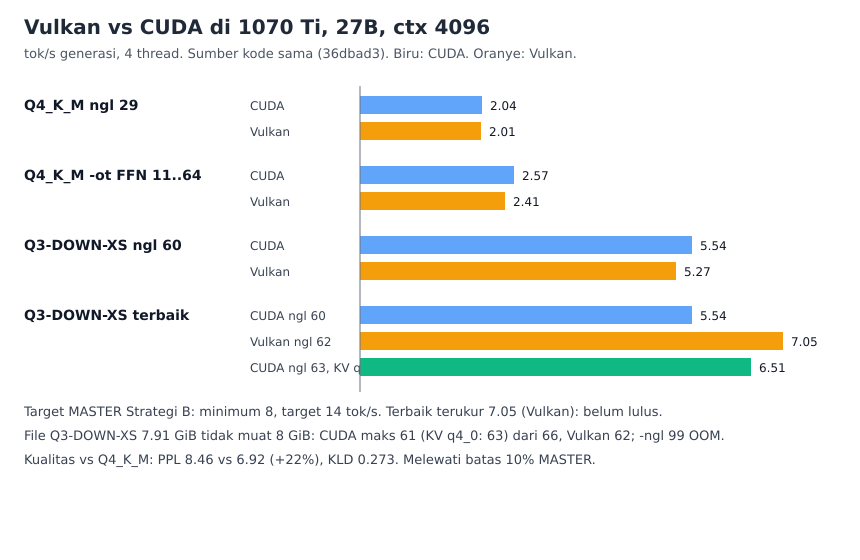

# 27B: Vulkan vs CUDA dan Strategi B (Q3-DOWN-XS), run-004

Bagian dari #34 dan #31. 2026-11-15, GTX 1070 Ti 8 GB, 4 thread, ctx 4096 (`llama-bench -p 0 -n 16 -d 4096`), KV f16. Alat: `tools/bench27b/ctx_bench.py`. Mentah: `~/27b-results/c4096-*.json`.

## Build Vulkan tanpa sudo (OQ-016)

- `glslc` tidak ada di sistem. Diunduh LunarG Vulkan SDK 1.4.363.1 (`vulkan-sdk.tar.xz`, 366 MB) ke `~/tools/1.4.363.1`, tanpa sudo. `glslc --version`: shaderc v2026.4.
- Header Vulkan sistem (`/usr/include/vulkan`, 1.3.204) ada; SDK dipakai untuk `glslc` dan header baru (`CPATH`).
- Konfigurasi: `cmake -S . -B build-vulkan -DGGML_VULKAN=ON -DGGML_CUDA=OFF -DVulkan_GLSLC_EXECUTABLE=~/tools/1.4.363.1/x86_64/bin/glslc -DVulkan_INCLUDE_DIR=.../include`. Build `llama-bench`, `llama-server`, `llama-perplexity` di `~/llama.cpp/build-vulkan` (sumber sama dengan build CUDA: commit `36dbad3`, patch iso3 hijau; iso3 tidak dipakai di Vulkan). Tidak ada BLOCKER.
- Perangkat terdeteksi: `Vulkan0: NVIDIA GeForce GTX 1070 Ti (8438 MiB)`, `fp16: 0`, `matrix cores: none`, warp 32.

## Vulkan vs CUDA, Q4_K_M

| Konfigurasi | CUDA | Vulkan | Vulkan vs CUDA | RAM tersedia terendah CUDA / Vulkan (GiB) |
|---|---:|---:|---:|---|
| `-ngl 28` | 2.00 | 1.94 | -3% | 13.45 / 12.39 |
| `-ngl 29` | 2.04 | 2.01 | -1.5% | 13.48 / 12.47 |
| `-ot` FFN 11..64 | 2.57 | 2.41 | -6% | 13.71 / 12.77 |
| `-ot` FFN 13..64 | OOM | 2.46 | Vulkan muat lebih banyak | - / 12.78 |
| `-ot` FFN 15..64 | OOM | OOM (alokasi compute 529 MiB) | - | |

Vulkan 1-6% lebih lambat pada Q4_K_M, memakai ±0.9 GiB lebih banyak RAM host, dan menampung satu-dua blok FFN lebih banyak sebelum OOM. Tidak ada crash saat decode dalam semua run yang berhasil dimulai.

## Strategi B: Q3-DOWN-XS asli

Bukan proxy. Berkas `guideboardlabs/Qwen3.8-27B-Q3-DOWN-XS-GGUF/Qwen3.8-27B-Q3-DOWN-XS.gguf`, 8 491 269 152 B, sha256 `f1e75d01...` cocok LFS oid. Definisi di RFC-001 adalah berkas ini (baris tabel, 7.68 GiB). Berkas itu **tidak butuh** BF16 maupun llama-quantize: BF16 (54 GB) tidak diunduh.

**[CONFLICT]** RFC-001/MASTER menulis 7.68 GiB; ukuran berkas nyata 7.91 GiB (8.49 GB). Mungkin 7.68 adalah angka model card lain; belum diketahui.

Muat 8 GiB? 7.91 GiB berkas + KV (±0.14 GiB di GPU) + RS state + buffer compute (±0.5 GiB) + konteks CUDA (±0.4 GiB) > 8 GiB. Terukur: CUDA `-ngl 99` OOM, `-ngl 62`/`64` OOM. Maksimum layer di GPU: **CUDA 61/66, Vulkan 62/66** (Vulkan 63, 64, 65, 99 gagal). Sisa ±1 GiB bobot di RAM (`CPU_Mapped` 1020 MiB di ngl 60).

| Konfigurasi | TPS | VRAM puncak (MiB) | RAM tersedia terendah (GiB) | Catatan |
|---|---:|---:|---:|---|
| CUDA `-ngl 52` | 3.32 | 7061 | 13.58 | |
| CUDA `-ngl 56` | 4.08 | 7503 | 13.61 | |
| CUDA `-ngl 60` (3 run) | **5.54** ± 0.11 | 7947 | 13.21 | |
| CUDA `-ngl 61` (3 run) | 5.13 ± 0.07 | 8053 | 12.97 | VRAM hampir penuh |
| CUDA `-ngl 62`, `64`, `99` | OOM | | | |
| CUDA auto-fit `-fitt 512` | 4.37 (57 layer) | 7609 | 13.62 | 21% di bawah `-ngl 60` |
| CUDA `-ot` FFN 40/50 (ngl 99) | 3.36 / 4.36 | 6899 / 7609 | | k≥60 tidak diuji |
| Vulkan `-ngl 60` | 5.27 | 7817 | 12.86 | |
| Vulkan `-ngl 62` (3 run) | **7.05** ± 0.07 | 8030 | 12.85 | tercepat terukur |
| Vulkan auto-fit `-fitt 512` | 5.90 (60 layer) | 7817 | 12.95 | |
| Vulkan `-ngl 63`..`99` | gagal (OOM saat buffer compute) | | | |

Catatan stabilitas Vulkan: dua percobaan `-ngl 63` awal gagal saat memuat model ("failed to load model") ketika proses lain milik pemilik (llama-server uji port 8095) masih memakai ±6.3 GiB VRAM. `-ngl 63` yang diulang saat GPU kosong gagal di alokasi buffer compute (OOM), bukan crash. Tidak ada crash decode. Satu mesin, ctx 4096, 16 token generasi.

### Prediksi vs hasil (B1)

| Baris | Prediksi | Terukur | Selisih |
|---|---|---|---|
| B1 TPS, 18.4 GB/s (RFC-001, issue #34) | 8.69 tok/s | 5.54 (CUDA), 7.05 (Vulkan) | CUDA -36%, Vulkan -19% |
| B1 TPS, 40 GB/s | 14.96 | 7.05 | -53% |
| MASTER minimum 8 / target 14 | | 7.05 terbaik | **minimum belum tercapai**, 12% di bawah |
| Layer di GPU | "±1.5 GiB tetap di RAM" (C-30) | ±1.0 GiB di RAM, 4-5 layer di CPU | arah benar |
| Muat penuh 8 GiB | tidak muat (C-30) | benar: `-ngl 99` OOM di kedua backend | prediksi benar |

Hipotesis selisih (belum diuji): prediksi memakai batas bandwidth RAM untuk bobot di CPU; 4-5 layer di CPU masih memakan sebagian besar waktu per token, ditambah transfer PCIe aktivasi. Selisih CUDA vs Vulkan (27%) bisa dari layer GPU lebih banyak (62 vs 60-61) dan overhead VRAM lebih kecil di Vulkan; belum dipisah.

Klaim komunitas 24.48 tok/s (RX 5700 XT, C-14) tidak tercapai di mesin ini (maks 7.05, 29%).

### Kualitas Q3-DOWN-XS vs Q4_K_M (protokol sama dengan quality-001)

wikitext-2-raw, ctx 512, 20 chunk, 4 thread, ngl 52 (CUDA), referensi `~/27b-results/q4km.kld` (dipakai ulang, tidak diubah):

| Model | PPL | mean KLD vs Q4_K_M | KLD p99 | same-top-p |
|---|---:|---:|---:|---:|
| UD-Q4_K_M (ref.) | 6.9192 ± 0.2395 | 0 | 0 | 100% |
| UD-IQ3_XXS | 7.2027 | 0.0604 | 0.58 | 88.88% |
| **Q3-DOWN-XS** | **8.4615 ± 0.2960** | **0.2728 ± 0.0077** | 2.80 | 78.16% ± 0.58 |

PPL +22.3% di atas Q4_K_M: **melewati batas 10%** MASTER. KLD 4.5 kali IQ3_XXS. Kecepatan 7.05 tok/s (Vulkan) vs 2.57 (Q4_K_M `-ot`): 2.7 kali lebih cepat dengan kualitas yang jauh turun. 86.5% di model card adalah terhadap kontrol 3-bit, bukan terhadap Q4_K_M.

### KV dan FlashAttention pada Q3-DOWN-XS (CUDA, ctx 4096, 1 run)

| Konfigurasi | TPS | VRAM puncak (MiB) |
|---|---:|---:|
| ngl 60, KV f16, `-fa` auto (off) | 5.54 (3 run) | 7947 |
| ngl 60, KV f16, `-fa 1` | 5.64 | 7947 |
| ngl 60, KV q8_0 (`-fa 1`) | 5.22 | 7831 |
| ngl 61, KV q8_0 | 5.37 | 7937 |
| ngl 62, KV q8_0 | 5.62 | 8045 |
| ngl 61, KV q4_0 | 5.66 | 7873 |
| ngl 62, KV q4_0 | 5.99 | 7981 |
| **ngl 63, KV q4_0** | **6.51** | 8095 |
| ngl 64 / 65, KV q4_0 | OOM | |

KV q4_0 membebaskan ±0.14 GiB, cukup untuk 2 layer lagi (63 vs 61), dan itu menaikkan TPS 17% (6.51 vs 5.54). Tetap di bawah Vulkan f16 (7.05) dan di bawah minimum 8. KLD KV q4_0 pada Q4_K_M 0.0024 (C-55); pada Q3-DOWN-XS tidak diukur. `-fa 1` +2% (di dalam simpangan ±0.11 run ulang), konsisten dengan C-58 bahwa FA tidak membantu. KV iso3 pada Q3-DOWN-XS tidak diukur: `llama-bench` menolak `-ctk iso3` (hanya `llama-server` dipakai untuk iso3, run lain); belum diuji.

## Yang tidak dikerjakan

- KV iso3 pada Q3-DOWN-XS (B3): belum; `llama-bench` tidak menerima iso3. KLD KV pada Q3-DOWN-XS belum.
- Kuantisasi ulang dari BF16 dengan imatrix: tidak perlu untuk Q3-DOWN-XS (berkas asli ada). Tidak dilakukan.
