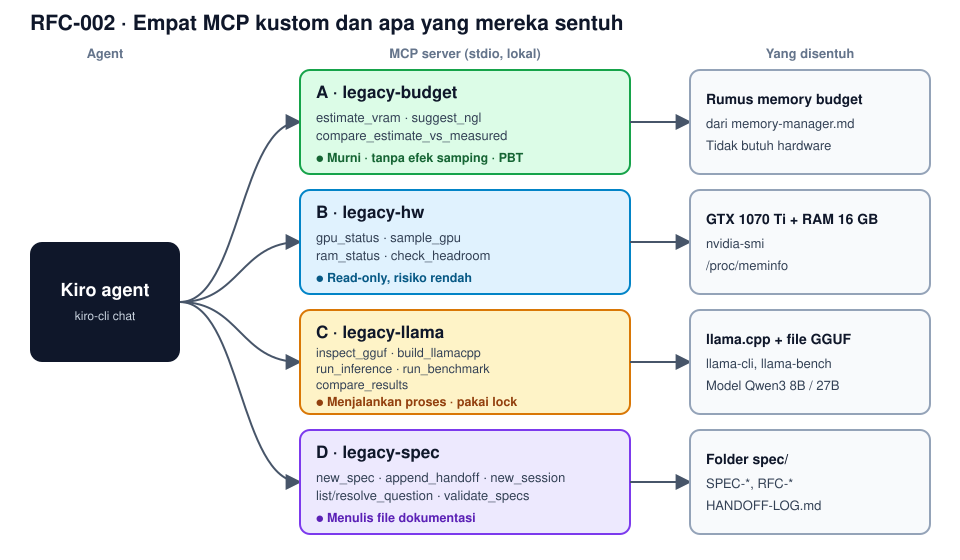

# RFC-002: CLI Tooling untuk legacy1070qi38

> Status: **Proposed** (untuk diskusi, belum diputuskan)
> Revisi: versi awal mengusulkan 4 MCP server. Diganti menjadi satu CLI karena lebih mudah dipasang dan dipakai orang lain.
> Diskusi: umbrella #1; per kelompok: A #2, B #3, C #4, D #5 (github.com/mcpe500/legacy1070qi38/issues)



---

## Summary

Satu file Python, `tools/legacy.py`, hanya memakai library standar. Isinya subcommand untuk menghitung memory budget, memantau hardware, menjalankan dan mengukur llama.cpp, dan merawat dokumen spec. Agent memanggilnya lewat bash, manusia lewat terminal. Setiap subcommand punya opsi `--json`.

> ⚠️ ASSUMPTION: perilaku bash tool di Kiro untuk proses panjang (timeout, background) belum diverifikasi.

---

## Motivation

- OQ-001 sampai OQ-008 hanya bisa dijawab lewat **pengukuran**.
- Menjalankan `nvidia-smi` dan `llama-cli` lewat shell bebas menghasilkan output tak terstruktur dan tanpa pengaman.
- Dokumen spec rawan tidak konsisten. Contoh nyata: penomoran NFR yang melompat ke NFR-04 di sesi bootstrap.
- Proyek ini ditujukan bagi pengguna GPU lama. Alat yang perlu dipasang dan didaftarkan terlebih dulu menghambat itu. `git clone` lalu jalan lebih sesuai.

---

## Subcommand

| Kelompok | Subcommand | Fungsi | Butuh GPU | Menjawab |
|---|---|---|---|---|
| A. `budget` | `estimate`, `suggest-ngl`, `compare` | Hitung VRAM, KV cache, jumlah layer GPU; bandingkan estimasi dengan hasil ukur | Tidak | Rumus di `memory-manager.md` |
| B. `hw` | `gpu`, `sample`, `ram`, `headroom` | VRAM, suhu, power, throttle; sampling peak; RAM dan swap; go/no-go | Ya | OQ-005, OQ-008 |
| C. `gguf`, `llama` | `gguf inspect`, `llama build`, `llama run`, `llama bench`, `llama compare` | Baca metadata GGUF tanpa memuat model; build SM 61; jalankan; benchmark 3x + sampling GPU | Sebagian | OQ-001..003, OQ-006 |
| D. `spec` | `new`, `handoff`, `session`, `questions`, `validate` | Scaffold spec, tambah entri handoff, kelola OQ, cek konsistensi dokumen | Tidak | Konsistensi dokumen |

Contoh:

```bash
python tools/legacy.py budget estimate --layers 36 --kv-heads 8 --head-dim 128 --bpw 5.5 --ctx 4096 --json
python tools/legacy.py gguf inspect models/qwen3-8b-q5_k_m.gguf --json
python tools/legacy.py llama bench --model models/qwen3-8b-q5_k_m.gguf --runs 3
python tools/legacy.py spec validate
```

---

## Keputusan Desain yang Diusulkan

1. **Satu file, library standar saja.** Pecah menjadi modul hanya jika melewati sekitar 1000 baris.
2. **Logika di fungsi Python, CLI hanya lapisan tipis.** Fungsi yang sama bisa dibungkus MCP nanti.
3. **Output `--json` di semua subcommand**, plus ringkasan yang enak dibaca manusia.
4. **Tanpa shell bebas.** Argumen divalidasi dengan `argparse`; binary dan path model memakai allowlist.
5. **Lock file** agar hanya satu inference berjalan sekaligus. Benchmark paralel merusak angka.
6. **Exit code bermakna**, misalnya `headroom` mengembalikan non-zero bila tidak cukup.
7. **Agent diberi tahu cara memakainya** lewat dokumen singkat `tools/README.md`, bisa dijadikan skill atau steering.
8. **Urutan:** `budget` → `gguf inspect` → `hw` → sisa `llama` → `spec`.

---

## MCP: Opsional di Akhir

MCP bukan lagi jalur utama. Pembungkus MCP (sekitar 50 baris, memanggil fungsi yang sama) ditambahkan hanya jika:
- ingin tool otomatis terdaftar dengan skema di Kiro, atau
- ingin bukti pemakaian MCP di `KIRO-USAGE.md`.

---

## Perbandingan dengan MCP Penuh

| | CLI (dipilih) | MCP server |
|---|---|---|
| Pemasangan | `git clone`, langsung jalan | Pasang dependensi, daftar di `mcp.json` |
| Pengguna | Agent, manusia, orang tanpa Kiro | Hanya agent |
| Agent mengenali tool | Lewat dokumen | Otomatis lewat skema |
| Proses panjang (27B) | Background lewat bash | Terikat timeout MCP (belum diverifikasi) |
| Bukti "pakai MCP" | Tidak ada, kecuali ada pembungkus | Ada |

---

## Open Questions

- [ ] Versi Python minimum yang didukung?
- [ ] `llama run` memanggil `llama-cli` per panggilan, atau mengelola `llama-server` yang tetap hidup (menghindari memuat ulang model 27B)?
- [ ] Bagaimana proses panjang dijalankan lewat bash tool Kiro (background + polling file status)? Belum diverifikasi.
- [ ] Hook Kiro yang menjalankan `spec validate` saat file spec disimpan: layak dipakai?
- [ ] Bagaimana menangani desktop environment yang ikut memakai VRAM saat benchmark?
- [ ] Apakah pembungkus MCP perlu dibuat?

---

*Terkait: `spec/specs/SPEC-006-benchmark-suite/`, `spec/AGENTS/roles/memory-manager.md`, `spec/AGENTS/roles/benchmarker.md`, `spec/AGENTS/KIRO-USAGE.md`.*
