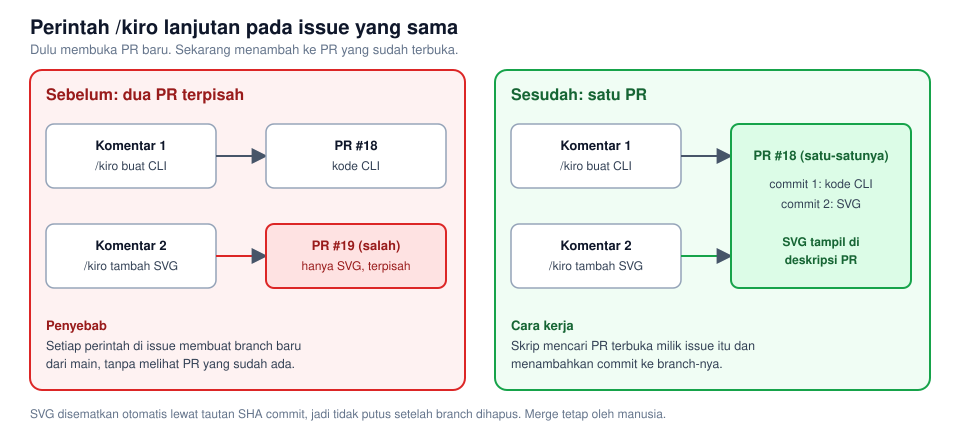
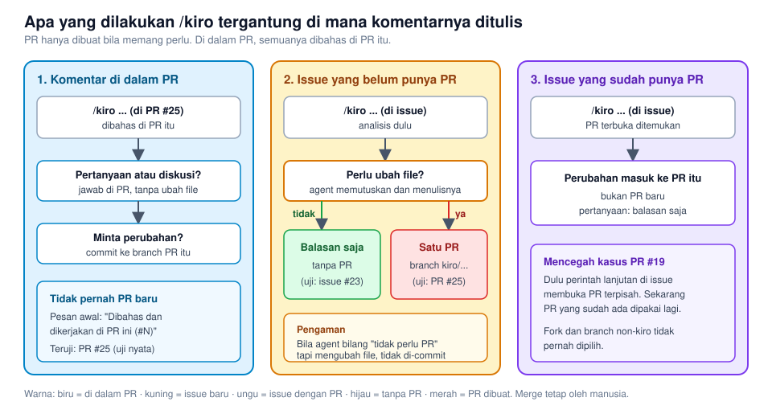

# RFC-003: Memicu Kiro CLI dari GitHub Issues

> Status: **Implemented (mode tanpa shell)**. Mode shell menunggu `bubblewrap` terpasang dan diuji.
> Kode: `tools/agent/` (lihat `tools/agent/README.md`)

## Summary

Skrip Python di laptop memantau issue dan komentar repo. Bila pengirimnya salah satu dari tiga ID yang diizinkan
dan teksnya diawali `/kiro`, skrip menjalankan `kiro-cli chat --v3 --no-interactive` memakai login Kiro yang sudah ada.
Perubahan file dikirim sebagai PR, tidak pernah langsung ke `main`.

## Keputusan

| Hal | Keputusan | Alasan |
|---|---|---|
| Tempat jalan | Laptop, bukan GitHub Actions | Memakai login yang ada (tanpa API key, yang butuh paket Kiro tertentu); GPU tersedia; tidak ada kode dari luar yang berjalan di mesin |
| Pemicu | Polling tiap 60 detik | Sederhana; tidak butuh port terbuka |
| Identitas | ID numerik: 68177813 (mcpe500), 73787745 (ibrahimmuh26), 113233053 (nicostap) | Username bisa berubah atau didaftarkan ulang |
| Perintah | Awalan `/kiro` | Komentar biasa tidak memakai kuota |
| Batas | 12 run per jam | Keputusan pemilik repo |
| PR dari fork | Diabaikan | Keputusan pemilik repo |
| Hasil | Balasan + PR dari branch `kiro/...` | Merge tetap oleh manusia |

## Model ancaman

| Ancaman | Penanganan | Diuji? |
|---|---|---|
| Orang luar menulis `/kiro` | Pengirim difilter dengan ID; tidak dibalas sama sekali | Unit test |
| Orang berusername sama tapi ID beda | Dicocokkan lewat ID | Unit test |
| Akun bot dengan ID terdaftar | Tipe harus `User` | Unit test |
| Orang luar mengedit komentar milik anggota | Komentar yang sudah diedit diabaikan | Unit test |
| Agent membalas dirinya sendiri (loop) | Penanda tersembunyi di semua balasan agen, dilewati | Unit test + uji nyata (dua komentar agen dilewati) |
| Teks orang luar di thread dipakai sebagai perintah | Hanya isi event pengirim yang sah yang menjadi instruksi. Isi issue milik orang luar tidak diberikan ke agent | Dirancang; belum diuji dengan akun luar |
| Agent membaca token atau kunci | Aturan `deny fs_read` untuk `~/.ssh`, `~/.config/gh`, folder status; tanpa shell | Uji nyata: pembacaan token `gh` ditolak |
| Agent mengubah skripnya sendiri | `deny fs_write` untuk `tools/agent`, `.github`, `.kiro`, `.git` + pemeriksaan ulang sebelum commit | Uji nyata: perubahan `config.json` ditolak |
| Agent menulis di luar worktree | Izin menulis hanya `./**`; selain itu "ask", yang ditolak pada mode non-interaktif | Uji nyata: `/tmp` tidak dibuat |
| Push ke `main` | Skrip hanya push ke branch `kiro/...`; branch protection di `main` | Branch protection: lihat catatan |
| Menyalahgunakan kuota | 12 run/jam, timeout 30 menit | Unit test untuk pembatas |
| Agent menyelipkan script di SVG | `svg_error` menolak `<script>`, event handler, `foreignObject`, entity | Unit test |
| Mention massal lewat keluaran agent | `@` dinetralkan di semua komentar dan PR | Unit test |

## Revisi: satu PR per issue, SVG di deskripsi

**Masalah yang ditemukan:** komentar `/kiro` di issue #1 yang meminta "tambahkan SVG di PR 18" membuat PR #19 terpisah.
Skrip selalu membuat branch baru dari `main` untuk perintah di issue, sehingga permintaan lanjutan menjadi PR sendiri.

| Perubahan | Cara |
|---|---|
| Perintah lanjutan menambah ke PR yang ada | Skrip mencari PR terbuka dari branch `kiro/issue-N[-...]` milik repo ini (bukan fork) dan memakai branch itu. PR tertinggi menang bila ada beberapa |
| SVG disematkan otomatis | Tautan memakai SHA commit, bukan branch, supaya tidak putus setelah branch dihapus |
| SVG divalidasi sebelum commit | XML valid; ditolak bila berisi `<script>`, event handler, `foreignObject`, atau entity; maksimum 500 KB |
| Peringatan tata letak | Perkiraan lebar teks terhadap kotak dan kanvas. Hanya peringatan, bukan penghalang |
| Peringatan PR tanpa visual | PR dengan 2 berkas atau lebih tanpa SVG diberi catatan |

Diuji nyata: satu issue, dua perintah `/kiro` berurutan menghasilkan satu PR dengan tiga berkas dan SVG tampil di deskripsi (issue dan PR uji sudah ditutup).

## Revisi 2: perilaku menurut tempat komentar

| Tempat `/kiro` ditulis | Perilaku |
|---|---|
| Di dalam PR | Dibahas dan dikerjakan di PR itu. Perubahan di-commit ke branch PR itu. Tidak pernah membuka PR baru |
| Di issue yang belum punya PR | Agent **analisis dulu** apakah perlu mengubah file. Pertanyaan, status, atau diskusi dijawab saja, **tanpa PR**. PR dibuat hanya bila instruksi jelas meminta perubahan file |
| Di issue yang sudah punya PR | Perubahan ditambahkan ke PR itu, bukan PR baru |

Pesan awal tiap komentar kini menyebut situasinya. Sebelumnya semua pesan menulis "membuat PR baru bila ada perubahan", termasuk saat komentar ada di dalam PR.

Pengaman: bila agent menulis "Keputusan: tidak perlu PR" tetapi meninggalkan perubahan file, perubahan itu tidak di-commit dan tidak ada PR yang dibuat.

Diuji nyata (artefak sudah ditutup): pertanyaan di issue menghasilkan balasan tanpa PR; permintaan perubahan di issue menghasilkan satu PR; di dalam PR, satu pertanyaan dijawab tanpa ubah file dan satu permintaan perubahan masuk ke branch PR yang sama.

## Yang belum terjamin

- **Prompt injection lewat web**: agent boleh `web_fetch`. Halaman web berbahaya bisa membujuknya menulis isi tertentu ke file atau balasan. Mitigasi: tanpa shell, PR perlu review, repo ini publik.
- **Mode shell** belum diaktifkan. Tanpa sandbox ia setara akses penuh ke akun Anda.
- **GPU di dalam sandbox** belum diuji.
- **Konsistensi isi balasan**: agent bisa keliru. Ringkasannya harus dibaca, bukan dipercaya begitu saja.
- **Tidak ada pemantauan biaya**: setiap run memakai kredit Kiro Anda.

## Open Questions

- [ ] Apakah `--sandbox` mengizinkan akses `/dev/nvidia*`?
- [ ] Apakah perlu `sandbox.json` global agar `--sandbox` aktif?
- [ ] Perlu layanan systemd agar skrip hidup kembali setelah reboot?
- [ ] Apakah agent perlu membaca thread issue (komentar anggota lain yang diizinkan) sebagai konteks?
