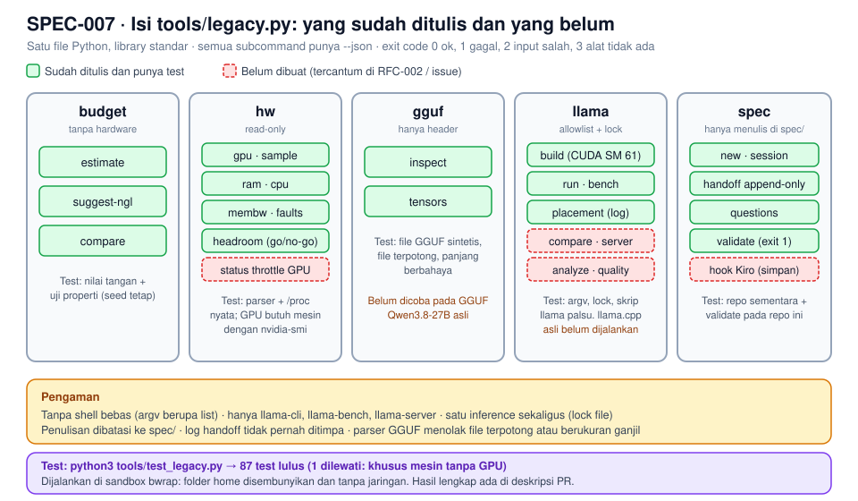
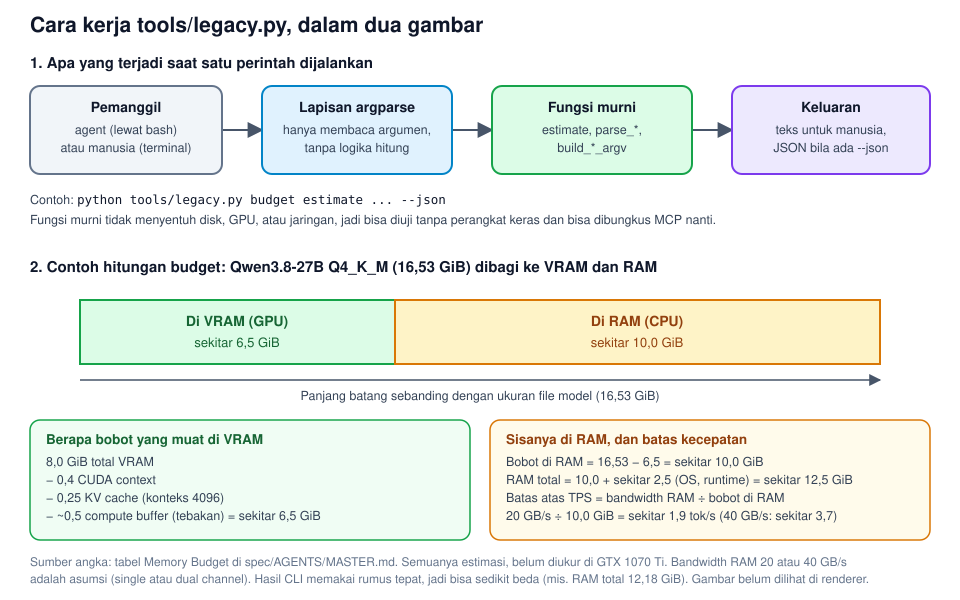

# Design — CLI Tooling (`tools/legacy.py`)

> Spec: SPEC-007 | Status: **Draft**
> Referensi: RFC-002, RFC-001 (Quantization Strategy), SPEC-003 (Memory Manager)

---

## Architecture Overview





Logika ada di fungsi murni. Lapisan argparse di bagian bawah file hanya membaca argumen, memanggil fungsi,
dan mencetak hasil. Fungsi yang sama bisa dibungkus MCP nanti tanpa mengubah logika.

```
tools/legacy.py
├── budget   estimate · suggest_ngl · compare_measured      (murni)
├── hw       parse_* (murni) + read_* (membaca /proc, nvidia-smi)
├── gguf     parse_gguf → summarize_gguf / summarize_tensors
├── llama    build_*_argv (murni) + InferenceLock + _run_logged
├── spec     scaffold_* · append_handoff · parse_questions · validate_spec
└── CLI      build_parser · main · render
tools/test_legacy.py   (unittest)
```

---

## Components

### budget

- **Rumus:** `kapasitas bobot di VRAM = VRAM − CUDA context − KV − compute buffer`; bobot sisanya di RAM; `RAM total = bobot di RAM + OS/runtime`; `waktu per token = bobot RAM / bandwidth RAM + bobot GPU / bandwidth GPU`.
- **KV per token** = `2 × layer_KV × kv_heads × head_dim × 2 byte × faktor tipe`. Default 16 × 8 × 128 memberi 64 KiB, sesuai MASTER.md.
- **Risiko:** merah bila headroom RAM < 0,5 GiB atau tidak ada ruang VRAM untuk bobot; kuning bila headroom RAM < 2 GiB; selain itu hijau. Batas 0,5 GiB dari `memory-manager.md`; batas 2 GiB adalah pilihan proyek ini.
- **Pascal:** tidak ada asumsi Tensor Core atau FP16 cepat; angka bandwidth saja.

### hw

- Parser (`parse_nvidia_csv`, `parse_meminfo`, `parse_cpuinfo`, `parse_vmstat`) menerima teks, jadi bisa diuji tanpa GPU.
- `headroom` memakai margin dari checklist `memory-manager.md`: 200 MB VRAM, 500 MB RAM.
- `membw` mengukur salinan memori satu thread di Python. Itu batas bawah kasar dan tidak membedakan single dari dual channel (OQ-011 butuh alat khusus).

### gguf

- Membaca magic, versi (2 atau 3), tabel metadata, dan tabel tensor. Tidak membaca data tensor.
- Batas pengaman: string 64 MiB, array 16 juta elemen, 1 juta pasangan kv, 4 juta tensor, kedalaman array 3.
- Array lebih dari 512 elemen diringkas menjadi `{"array_len": n}` agar keluaran kecil.
- Ukuran tensor = `elemen / blok × byte per blok`, dari tabel tipe ggml di kode. ⚠️ ASSUMPTION: tabel ditranskripsi dari pengetahuan atas format ggml, belum dicocokkan baris demi baris dengan sumber saat ini. Tipe yang tidak dikenal menghasilkan `nbytes = null` dan dihitung di `tensors_unknown_size`.
- `kv_layers_estimate` adalah heuristik (entri `head_count_kv` > 0, atau `block_count`). Nama kunci model hibrida belum diverifikasi.

### llama

- `llama-cli`, `llama-bench`, `llama-server` adalah satu-satunya nama binary yang bisa dipilih; path dibentuk dari `--bin-dir`.
- Prompt dikirim sebagai satu elemen argv. Tidak ada shell.
- `InferenceLock` membuat file lock dengan `O_EXCL` dan menulis PID. Lock lama (PID mati atau isi tidak valid) diganti.
- `--ngl` kosong berarti auto-fit llama.cpp (OQ-014). Menguji manual dan auto-fit tetap pekerjaan SPEC-005.
- ⚠️ ASSUMPTION: opsi `-o json`, `-r`, `-no-cnv` ada di build llama.cpp yang dipakai, dan bentuk baris timing serta log pemuatan mengikuti keluaran umum. Format berbeda antar versi.

### spec

- Semua penulisan lewat `spec_dir(root)/...`; `name` hanya `[a-z0-9-]`, maksimum 61 karakter, jadi tidak bisa memuat `/` atau `..`.
- File dibuat dengan mode `x` (gagal bila ada). `HANDOFF-LOG.md` dibuka dengan mode `a`.
- `validate` memeriksa: tiga file per `SPEC-NNN-*`, penomoran FR/NFR berurutan tanpa celah, tautan relatif di semua `.md` di bawah `spec/` (kode dan blok kode diabaikan), dan duplikasi OQ di tabel (peringatan).
- `questions` membaca tabel OQ, baris `[OPEN] OQ-NNN`, dan daftar id di awal baris `[RESOLVED]`. Kalimat bebas di baris RESOLVED tidak dibaca.

---

## Configuration

| Parameter | Default | Keterangan |
|---|---|---|
| `--vram-gib` / `--ram-gib` | 8 / 16 | Hardware target |
| `--ctx` | 4096 | Konteks untuk KV |
| `--kv-layers` / `--kv-heads` / `--head-dim` | 16 / 8 / 128 | ⚠️ turunan dari 64 KiB/token, belum dikonfirmasi |
| `--cuda-ctx-gib` / `--compute-gib` / `--os-gib` | 0.4 / 0.5 / 2.5 | Tebakan di MASTER.md |
| `--ram-bw-gbs` / `--gpu-bw-gbs` | 20 / 256 | RAM: asumsi single channel; ukur dengan `hw membw` |
| `--lock-file` | `<tmp>/legacy1070qi38.lock` | Satu inference sekaligus |
| `--timeout` | 600 (run/bench), 3600 (build) | Detik |

---

## Memory Budget

Contoh Q4_K_M 16,53 GiB, konteks 4096 (dihitung tangan dan dipakai sebagai test):

```
KV            0.25 GiB
VRAM tetap    0.40 + 0.25 + 0.50 = 1.15 GiB
Bobot di VRAM 6.85 GiB       Bobot di RAM 9.68 GiB
RAM total     9.68 + 2.5 = 12.18 GiB   headroom 3.82 GiB   risiko hijau
TPS batas atas ≈ 1.82 (RAM 20 GB/s, GPU 256 GB/s)
```

Angka ini sedikit berbeda dari tabel MASTER.md (RAM ~12,5 GiB) karena MASTER memakai kapasitas VRAM ~6,5 GiB; CLI memakai rumus tepat dengan parameter di atas.

---

## Edge Cases dan Error Handling

| Kasus | Penanganan |
|---|---|
| Angka nol, negatif, NaN, tak hingga, bool | `CliError`, exit 2 |
| File GGUF terpotong, magic salah, versi 1 | `CliError`, exit 2 |
| Panjang string/array/jumlah tensor tidak masuk akal | Ditolak sebelum alokasi, exit 2 |
| `nvidia-smi` atau binary llama tidak ada | `EnvError`, exit 3 |
| Inference lain berjalan | `CliError` menyebut file lock, exit 2 |
| Proses melewati `--timeout` | Proses dihentikan, lock dilepas, exit 2 |
| Proses llama keluar dengan kode ≠ 0 | Kode dan ekor stderr dilaporkan, exit 1 |
| Nama spec berisi `/`, `..`, spasi, huruf besar | Ditolak, tidak ada file dibuat |
| Entri handoff berisi baris baru atau ``` | Ditolak (merusak blok kode log) |

---

## Open Questions

- [ ] Versi Python minimum (NFR-05)
- [ ] `llama run` per panggilan atau `llama-server` yang tetap hidup (OQ di RFC-002)
- [ ] Cara menjalankan proses panjang lewat bash tool Kiro; implementasi sekarang sinkron dengan `--timeout`
- [ ] Apakah tabel tipe ggml cocok dengan versi llama.cpp yang dipakai
