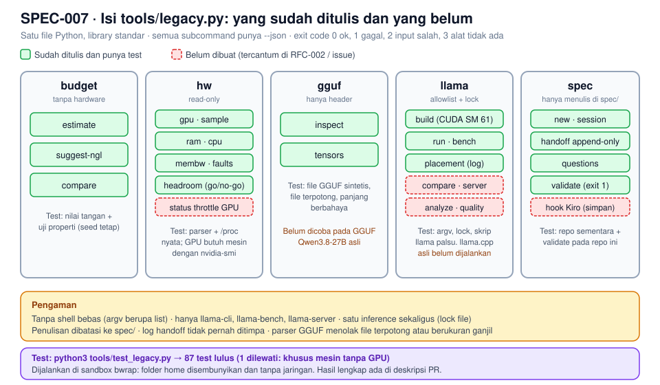

# tools/legacy.py

CLI untuk proyek legacy1070qi38. Satu file, hanya library standar Python. Setiap subcommand punya `--json`.
Spec: `spec/specs/SPEC-007-cli-tooling/`. Desain: `spec/specs/RFC-002-cli-tooling.md`.



> Status: test unit dan test kontrak dengan binary llama.cpp asli sudah dijalankan (lihat "Test").
> Python minimum: 3.8 (sintaks), tetapi **hanya 3.10.12 yang diuji**.

## Contoh

```bash
# Estimasi memory (tanpa GPU)
python tools/legacy.py budget estimate --file-gib 16.53 --vram-gib 8 --ctx 4096 --json
python tools/legacy.py budget suggest-ngl --file-gib 16.53 --layers 64
python tools/legacy.py budget compare --file-gib 16.53 --measured-ram-gib 12.5 --measured-tps 1.4

# Hardware
python tools/legacy.py hw gpu --json
python tools/legacy.py hw headroom --file-gib 16.53        # exit 1 bila tidak cukup
python tools/legacy.py hw membw                            # coba 1,2,4,.. thread; ambil terbaik
python tools/legacy.py hw sample --count 20 --interval 1   # puncak VRAM/suhu/daya, clock, throttle, RAM terendah, swap

# Header GGUF (tidak memuat bobot)
python tools/legacy.py gguf inspect models/Qwen3.8-27B-Q4_K_M.gguf --json
python tools/legacy.py gguf tensors models/Qwen3.8-27B-Q4_K_M.gguf

# llama.cpp (tambah --dry-run untuk melihat argv saja)
python tools/legacy.py llama build --src ../llama.cpp --dry-run
python tools/legacy.py llama run --model models/Qwen3.8-27B-Q4_K_M.gguf --prompt "Halo" --ctx 2048
python tools/legacy.py llama bench --model models/Qwen3.8-27B-Q4_K_M.gguf --runs 3
python tools/legacy.py llama placement --log load.log
python tools/legacy.py llama bench --model m.gguf --json > a.json    # simpan hasil
python tools/legacy.py llama compare a.json b.json                   # lebih cepat / lebih lambat / sama

# Analisis: apa yang menahan? (efisiensi terhadap batas bandwidth)
python tools/legacy.py bench analyze --bench-json a.json --gguf m.gguf --gpu-fraction 1
python tools/legacy.py bench analyze --gen-tps 2.1 --gguf m.gguf --gpu-fraction 0.4 --ram-bw-gbs 20

# Kualitas (butuh llama-perplexity: llama build --target llama-perplexity)
python tools/legacy.py quality ppl --model m.gguf --file wiki.test.raw --chunks 20 --bin-dir build/bin
python tools/legacy.py quality kld --base-model ref.gguf --model q3.gguf --file wiki.test.raw \
       --chunks 20 --kld-file /tmp/ref.kld --bin-dir build/bin     # berkas logit BESAR: ~0.12 GiB per chunk (vocab 248k)
python tools/legacy.py quality kld --base-model m.gguf --model m.gguf --kv-type q8_0 --file wiki.test.raw \
       --chunks 20 --kld-file /tmp/f16.kld --bin-dir build/bin     # dampak KV quant pada model yang sama
python tools/legacy.py quality prompts --model m.gguf --prompts tools/quality/prompts-v1.txt --out a.json
python tools/legacy.py quality prompts --compare a.json b.json

# Dokumen
python tools/legacy.py spec validate
python tools/legacy.py spec new nama-fitur --title "Nama Fitur"
python tools/legacy.py spec handoff --type finding --text "ringkasan satu baris"
python tools/legacy.py spec questions
```

## Exit code

| Kode | Arti |
|---|---|
| 0 | Berhasil |
| 1 | Cek gagal: no-go, validasi gagal, di luar toleransi, proses llama keluar ≠ 0 |
| 2 | Input salah (termasuk lock sedang dipegang, timeout) |
| 3 | `nvidia-smi`, binary, atau file tidak ada |

## Pengaman

- Tanpa shell: argumen proses berupa list.
- Binary hanya `llama-cli`, `llama-bench`, `llama-server`, `llama-perplexity` di `--bin-dir`.
- stdin proses anak ditutup (`DEVNULL`) dan `llama run` memakai `-st`; tanpa itu `llama-cli` menunggu input selamanya.
- Satu inference sekaligus lewat lock file.
- `spec` menulis hanya di bawah `spec/`; `HANDOFF-LOG.md` hanya ditambah di akhir.

## Test

```bash
python tools/test_legacy.py -v
# atau
python -m unittest discover -s tools -p "test_legacy.py" -v
```

Test kontrak dengan binary asli (dilewati bila variabel tidak diset; paksa CPU, tidak menyentuh VRAM):

```bash
LEGACY_LLAMA_BIN_DIR=/path/build/bin LEGACY_TEST_MODEL=/path/model-kecil.gguf python tools/test_legacy.py RealBinaryContract -v
```

Catatan: test `llama` memakai skrip shell palsu di folder sementara (butuh folder tanpa `noexec`). Test GPU hanya
berjalan di mesin tanpa `nvidia-smi` (memeriksa exit 3). Test kernel Gated DeltaNet di Pascal (OQ-009) bukan bagian dari
alat ini.

## Batas yang diketahui

| Hal | Keadaan |
|---|---|
| `hw membw` | Laju salin `memmove`; batas bawah laju baca. Tidak membedakan single/dual channel |
| `bench analyze` | Batas atas dari bandwidth; efisiensi > 1 berarti asumsi bandwidth terlalu rendah |
| `quality kld` | Berkas logit referensi besar (vocab 248.320: ±0.12 GiB per chunk pada ctx 512) |
| KV `iso3` | Hanya CUDA di fork; build CPU **segfault** (kode -11) saat `quality kld --kv-type iso3` |
| `llama-server` | Tidak dibungkus; benchmark memakai binary per panggilan agar hasil terkontrol |
| Pembungkus MCP | Tidak dibuat (keputusan di RFC-002) |
| Python | Hanya 3.10.12 yang diuji |
