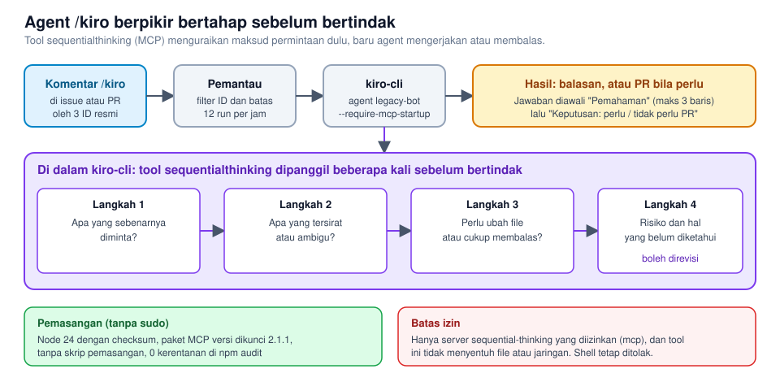

# Agen GitHub → Kiro CLI

Skrip ini memantau issue dan komentar di repo, lalu menjalankan **Kiro CLI yang terpasang di laptop ini**
(memakai login Anda, tanpa API key) bila ada perintah `/kiro` dari tiga pengguna yang diizinkan.
Desain dan alasannya: `spec/specs/RFC-003-github-agent-trigger.md`.

## Cara pakai

```bash
python3 tools/agent/kiro_gh_agent.py install-agent   # sekali: tulis profil ke ~/.kiro/agents
python3 tools/agent/kiro_gh_agent.py run             # pantau terus-menerus (Ctrl+C untuk berhenti)
```

Lalu tulis issue atau komentar yang **diawali** `/kiro`:

```
/kiro Tambahkan tabel perbandingan quant di spec/research/CLAIMS.md
```

| Perintah | Fungsi |
|---|---|
| `run` | Pantau terus. Tambahkan `--dry-run` untuk hanya melihat keputusan |
| `once` | Satu kali poll |
| `status` | Kursor, jumlah run 1 jam terakhir, status mode shell |
| `install-agent` | Tulis profil agent (`--force` untuk menimpa) |

Agar berjalan di latar belakang: `nohup python3 tools/agent/kiro_gh_agent.py run > ~/.kiro-agent/run.log 2>&1 &`

## Aturan

| Aturan | Isi |
|---|---|
| Siapa | Hanya ID numerik di `config.json` (`allowed_users`): mcpe500, ibrahimmuh26, nicostap. Tipe harus `User` |
| Pemicu | Isi komentar atau issue **diawali** `/kiro`. Teks setelahnya menjadi instruksi |
| Diabaikan | Pengirim lain, komentar yang sudah diedit, komentar buatan agen, PR dari fork, issue/PR yang sudah ditutup |
| Batas | 12 run per jam (`max_runs_per_hour`). Kelebihannya ditunda dan dibalas sekali |
| Hasil | Balasan di thread. Bila ada perubahan file: commit di branch `kiro/issue-N-...` dan PR. Tidak pernah push ke `main` |
| Tempat komentar | **Di dalam PR**: dibahas dan dikerjakan di PR itu. **Di issue tanpa PR**: agent analisis dulu, pertanyaan dijawab tanpa PR, PR dibuat hanya bila instruksi meminta perubahan file. **Di issue yang sudah punya PR**: perubahan masuk ke PR itu |
| Satu PR | Perintah `/kiro` lanjutan pada issue yang sama **menambah ke PR yang sudah terbuka**, bukan membuat PR baru. Komentar langsung di PR juga menambah ke PR itu |
| SVG di PR | SVG yang diubah divalidasi (XML valid, tanpa script), lalu disematkan di deskripsi PR lewat tautan SHA. Tata letak diperiksa dengan perkiraan lebar teks dan peringatannya ditulis di PR. PR berisi banyak berkas tanpa SVG diberi peringatan |
| Terlindungi | Agent tidak boleh mengubah `tools/agent/`, `.github/`, `.kiro/`, `.git/`. File > 5 MB ditolak |

Komentar yang sudah diedit sengaja diabaikan. Bila perlu mengubah perintah, tulis komentar baru.

## Berpikir bertahap (Sequential Thinking MCP)

Agent diwajibkan memakai tool `sequentialthinking` untuk menguraikan maksud permintaan sebelum bertindak, lalu
menulis bagian **Pemahaman** (maks 3 baris) di jawabannya agar Anda bisa memastikan maksudnya benar.



```bash
tools/agent/install-sequential-thinking.sh                        # Node 24 + paket MCP (versi dikunci), tanpa sudo
python3 tools/agent/kiro_gh_agent.py install-agent --force        # daftarkan ke profil agent bot
```

| Hal | Isi |
|---|---|
| Yang dipasang | Node.js 24 di `~/.local/opt` (checksum SHA-256 diverifikasi) dan paket di `~/.local/share/kiro-mcp` |
| Jalur di `config.json` | Kunci `sequential_thinking` (`node`, `entry`). Bila tidak ditemukan, agent berjalan tanpa tool itu dan mengatakannya |
| Bila server gagal naik | Run gagal dengan jelas (`--require-mcp-startup`), tidak diam-diam tanpa berpikir |
| Biaya | Beberapa pemanggilan tool tambahan per run, jadi sedikit lebih lama dan lebih banyak kredit |
| Sesi Kiro interaktif Anda | Kiro melarang agent menulis ke `~/.kiro/settings/`. Jalankan sendiri `kiro-cli mcp add ...` (dicetak di akhir skrip pemasangan) |

## Mode shell (untuk menjalankan test)

Default-nya **tanpa shell**: agent bisa membaca, menulis, dan mencari di web, tapi tidak bisa menjalankan test.
Alasannya, tanpa sandbox sebuah shell bisa membaca token `gh` Anda lewat `python3 -c ...`, karena aturan izin file
hanya berlaku untuk tool file, bukan perintah shell.

Untuk mengaktifkannya:

```bash
sudo apt install bubblewrap socat        # perlu password sudo Anda
# ubah "allow_shell": true di tools/agent/config.json, lalu:
python3 tools/agent/kiro_gh_agent.py install-agent --force
python3 tools/agent/kiro_gh_agent.py status      # mode_shell harus true
```

Bila `allow_shell` true tapi `bwrap` tidak ada, skrip otomatis kembali ke mode tanpa shell.

> ⚠️ Belum diuji: apakah sandbox masih mengizinkan akses ke GPU (`/dev/nvidia*`), dan apakah `--sandbox`
> cukup tanpa `sandbox.json`. Uji sebelum mengandalkannya untuk benchmark.

## Berkas

| Berkas | Isi |
|---|---|
| `kiro_gh_agent.py` | Skrip utama (hanya library standar) |
| `config.json` | Daftar ID, batas, path terlindungi |
| `test_agent.py` | 73 unit test: filter keamanan, PR tunggal, validasi SVG, niat per tempat komentar, Sequential Thinking: `cd tools/agent && python3 -m unittest` |

Status dan log ada di `~/.kiro-agent/` (state.json, logs/). Worktree sementara di `~/.kiro-agent-work/`.
Agent dilarang membaca folder status itu.

## Mematikan

`Ctrl+C` pada proses `run`, atau `pkill -f kiro_gh_agent.py`. Untuk mencabut akses seseorang, hapus ID-nya dari `config.json`.
